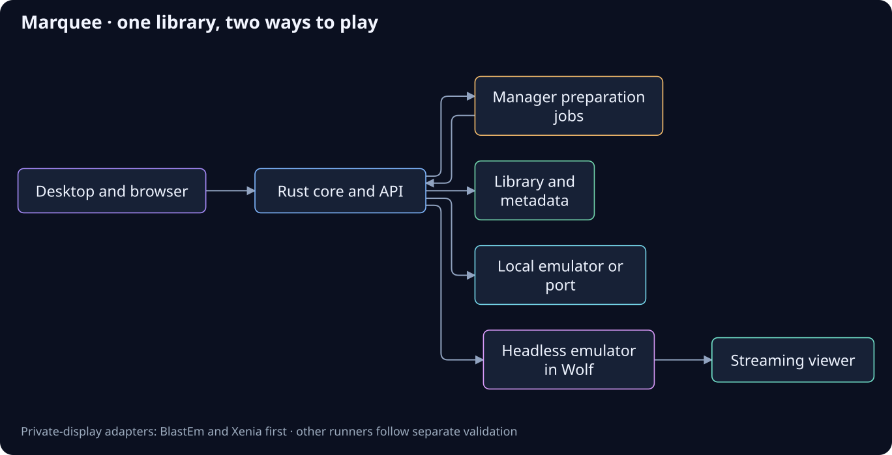

# Marquee

A Fedora/Linux game library and launcher with managed emulators, native ports,
game media and private-display streaming. The desktop app and authenticated
browser UI share one Rust core and library.

## Features

- **Unified library:** platform shelves, search, favourites, editions, play history,
  and a per-game emulator selector with a clear platform default.
- **Managed emulation:** supported console adapters, pinned runtime installs/source
  builds, BIOS/firmware setup and separate settings/save folders. PS3 and Xbox 360
  have direct verified-ISO launch adapters; compatibility remains title-specific.
- **Downloads and preparation:** background manager jobs for reviewed archives,
  torrent transport and browser-assisted downloads, with resumable history and
  verified installation receipts.
- **Native ports and discovery:** managed port/recomp recipes, local Quiver app-list
  import and a link to its community catalogue. Required original assets remain
  part of each recipe's setup.
- **Artwork and metadata:** cached covers and game facts, provider search with
  release review, and automatic enrichment after supported imports.
- **Game media:** linked soundtracks, a music player, image/video collections and
  reviewed YouTube/yt-dlp workflows.
- **Headless streaming:** private display/audio through Wolf and a managed viewer.
  Library Stream launches begin with BlastEm and Xenia; other runners need their
  own adapters and acceptance. Streamed saves are separate from local profiles.

Steam has read-only inventory and launches through its official client. Direct
Epic/GOG installation, portable package export/import and library-wide streaming
for every runtime remain unfinished. PS4/PS5 tool entries do not establish playable
game compatibility. See the [roadmap](docs/ROADMAP.md) and [documentation index](docs/README.md).

## Architecture



Marquee owns the library and launch decisions. The hidden `marquee-manager` owns
supported acquisition/preparation jobs; downloaded files become library entries
only after validation. Emulator programs, original sources, firmware and writable
profiles have separate lifecycles. See [storage design](docs/STORAGE_LAYOUT.md)
and the [portable package proposal](docs/PORTABLE_PACKAGES.md).

The diagram uses Aircloud Creative Studio's **ELK** auto-layout engine. Its
[editable source](docs/diagrams/architecture.mmd), [layout data](docs/diagrams/architecture.layout.json)
and [render script](scripts/render-architecture.ts) are included. To regenerate
with the sibling Studio checkout and its installed dependencies:

```bash
../aircloud-creative-studio/node_modules/.bin/tsx scripts/render-architecture.ts
```

## Run

**Native streaming:** Wolf API controls are available through `marquee streaming
--socket /absolute/path/wolf.sock` (inspect, pending, pair, unpair, stop). Native
`streaming build`, `runtime-status`, `probe` and `rollback` manage a pinned local
source build with software/NVIDIA checks and image receipts. ST2 Fedora-to-itself
passed 2026-10-24 (synthetic stream and Sonic/BlastEm in Wolf's virtual desktop,
keyboard/mouse, saves, disconnect/reconnect). Library-owned headless launch is available for BlastEm and Xenia. First-run
host setup UI, an embedded receiver and a second-device gate remain open.
See [source reuse, commands and gates](docs/STREAMING.md).

Needs Node 22+, pnpm (`corepack enable pnpm`), and Rust for the desktop/CLI. On Fedora, install WebKit and the other Tauri devel packages first:

```bash
./scripts/setup.sh                # Fedora devel packages, then checks rustc / node / pnpm
(cd apps/desktop && pnpm install)
./scripts/run.sh desktop          # optimized app, built when needed; no Vite/web server
./scripts/run.sh dev              # explicit browser development with hot reload
```

Desktop rendering automatically uses an accelerated shared-memory transport on NVIDIA/Wayland. `MARQUEE_RENDERER=software ./scripts/run.sh desktop` retains the compatibility fallback. See [rendering modes, production launch and live benchmark results](docs/DESKTOP_RENDERING.md).

CLI (same core; use `--data-dir` for an isolated database):

```bash
cargo run -p marquee-cli -- --data-dir /tmp/marquee-dev library add-root --system ps2 ~/Games/ps2
cargo run -p marquee-cli -- --data-dir /tmp/marquee-dev scan
cargo run -p marquee-cli -- --data-dir /tmp/marquee-dev list --system ps2 --json
cargo run -p marquee-cli -- --data-dir /tmp/marquee-dev runners install --channel auto
cargo run -p marquee-cli -- --data-dir /tmp/marquee-dev artwork refresh
cargo build -p marquee-manager -p marquee-cli        # scripts/run.sh builds the companion automatically
cargo run -p marquee-cli -- prepare inspect /absolute/path/Game.zip --system genesis
cargo run -p marquee-cli -- prepare run JOB_ID --review-token TOKEN_FROM_INSPECTION
cargo run -p marquee-cli -- prepare start JOB_ID --review-token TOKEN_FROM_INSPECTION  # detach
cargo run -p marquee-cli -- prepare list             # register pending receipts
cargo run -p marquee-cli -- manager status           # also: manager start | stop
cargo run -p marquee-cli -- intake "Game (USA).zip"    # legacy immediate importer
cargo run -p marquee-cli -- emulators build blastem   # Linux x86_64; Git + rootless Podman
cargo run -p marquee-cli -- --data-dir /tmp/marquee-dev ports install zelda64recomp   # also: ports list | check | launch
```

**One app, two surfaces, run separately.** The desktop app is standalone and opens no port by default. Set `MARQUEE_WEB=1` (or `MARQUEE_PORT=<port>`) and it also serves the same UI and library on `127.0.0.1` (default port 47820). For the web alone, run `scripts/run.sh web` (`marquee run web`) with no window. Settings → Web access copies an address ending in `#token=…`; open it in a browser on the same computer and you get the identical UI with the same games, covers, ports and launches, and both surfaces see each other's changes live. Every UI build is stamped; a window or tab left open across a rebuild shows a “Reload” banner instead of silently running old code. Headless: `marquee run web` (after `pnpm build`). While developing, `scripts/run.sh dev` waits for a healthy backend and opens the authenticated Vite URL (`http://localhost:1420/#token=…`). It proxies API and artwork to the backend's actual selected port, reuses a running web-enabled desktop for the same library, and honors `MARQUEE_DATA_DIR` (or `--data-dir PATH`) instead of opening another database. A desktop started without web access must be closed or relaunched with `scripts/run.sh both`; an occupied library now stops dev before Vite starts. `MARQUEE_DEV_PORT` changes Vite's port; `MARQUEE_API_URL` can select an existing loopback backend outside the default port range. The server is loopback-only, needs the token for every API and cover request, and rejects foreign `Host` headers. The token lives in `<data dir>/server.token` (mode 600).

**Demo (`pnpm dev`, no token, or `?demo=1`)** still uses invented titles and simulated playtime. Controller input in the browser is not evidence for the Tauri window.

**Desktop** uses the real library and the same Home/Games/Music/Media/Tools/Streaming/Settings chrome as the demo. With no imported media or enabled source it is empty; the optional legacy Lutris bridge stays disconnected until explicitly enabled. Install PCSX2 from Home, Games, or Settings: Marquee downloads the official AppImage and unpacks it into its own data dir (no Flatpak wizard). Point library roots at your disc folders (automated acquisition jobs are the target); covers are looked up by disc serial and cached. **Native ports** appear as tagged games, with engine installation/configuration in Tools; retail data should eventually flow from store/detection jobs, with **Open folder** as fallback today. **Tools → Purple for Aion 2** provides managed setup and opening with progress, stop/retry and private diagnostics; Purple performs account sign-in, game downloads and patching. This is an unverified Linux compatibility recipe. A persistent Downloads screen is not implemented; Purple progress is on its Tools card. Other Windows-app recipes remain demo-only.

Dev URL params: `?route=library`, `?mode=big`, `?theme=light`, `?game=<id suffix>`, `?add=1`, `?splash=0`, `?motion=0`, `?empty=1` (demo with no sample games, for the empty desktop look).

Before pushing, run `scripts/check.sh` (there is no hosted CI). It formats and tests the Rust core/CLI, compiles the desktop crate (prints `BLOCKED` if WebKit/DBus devel are missing; **fails** if they are present and compile errors), then `pnpm check` / `pnpm test` / `pnpm build`. Frontend-only: `pnpm test` inside `apps/desktop/`.

## Layout

```
apps/desktop/   Svelte 5 + TypeScript + Vite UI and Tauri 2 shell
crates/core/    library DB/receipt import, scan, launch/session adapters, command layer, events, web server
crates/manager/ hidden preparation worker, private socket/client, jobs/receipts and ownership migration
crates/media/   shared bounded archive/CUE/ISO helpers, catalogue and errors
crates/cli/     `marquee` diagnostics over the same core
catalog/        system/emulator/port descriptors, source builds and streaming recipes
scripts/        setup.sh, run.sh, check.sh, make-icon.py
docs/           ROADMAP.md, STORE_INTEGRATION.md, PS2.md, PS1.md, UNIFIED_LIBRARY.md, and supporting notes
```

## Secrets

Keys (SteamGridDB, Steam Web API, SteamID, IGDB/Twitch, RAWG) are managed in **Settings → API keys**, in the native app and in the browser surface alike. A value is read from, in order: what you saved in Marquee, the process environment, then a `.env` file (see `.env.example`; git-ignored). Saved values live in `<config dir>/keys.json`, readable only by you, and the UI only ever sees where a key comes from and its last four characters, never the value. Adding a key to Marquee is one entry in `crates/core/src/keys.rs`. Never put a Steam password anywhere: Marquee launches through the Steam client, which keeps its own login. Cover refresh uses a SteamGridDB key when configured; IGDB and RAWG remain unused infrastructure for later artwork and Steam extras.

## License

[MIT](LICENSE).

## Unified library and correction pass

See [the unified-library model, Jak/OpenGOAL example, and next implementation milestone](docs/UNIFIED_LIBRARY.md) and [the correction report](docs/CORRECTIONS.md). The browser demo now includes a Jak edition/run selector; the real library includes installed native ports alongside discs.

## UI and navigation

See the [UI/UX implementation record and remaining visual acceptance](docs/UI_UX.md). Home contains personal library entries; catalogue records have their own discovery view. Installed port engines are labeled as needing unchecked game setup rather than automatically Ready to play. Settings groups everyday preferences separately from provider keys and library maintenance.

## Tools and launchers

The desktop defaults to **Balanced** visual effects to avoid large blur and grain passes. Settings → Look and feel offers Full effects and Reduce motion. See the [performance findings, fixes and remaining native profiling checks](docs/DESKTOP_RENDERING.md).

**Tools → Emulators → mGBA** now offers a pinned source-build pilot with progress, logs, cancellation/retry and previous-version rollback. Compiler and runtime dependencies stay in rootless Podman; GB/GBC/GBA library import remains follow-up work. See [source builds and verification](docs/EMULATORS.md#source-builds-mgba-pilot) and [game-only/headless modes](docs/EMULATORS.md#game-only-windows-and-headless-emulation).

The target normal flow detects and manages store helpers automatically. The current custom shortcut editor is an advanced feature, not the planned account-connection workflow. Use **Tools → Add launcher** to configure existing apps, AppImages, or native runtimes. Saved launchers support individual arguments, a working directory, readiness checks, and pinning. Steam/Lutris/Heroic command detection is included. See [launcher setup, supported behavior, and verification](docs/LAUNCHERS.md).

## Legacy Lutris bridge

The read-only Lutris bridge is explicitly optional. Tools → Legacy integrations reveals its connection settings; a fresh setup never reads its game database or imports cached store listings automatically. Existing explicitly saved connections remain enabled, and disconnecting removes only the projected view. Available database paths can be suggested without opening them. No Lutris files, prefixes or credentials are changed. No further Lutris setup/import work is required for the direct-store milestones. See [bridge behavior and its superseded priority](docs/LAUNCHERS.md#legacy-lutris-library-bridge).
