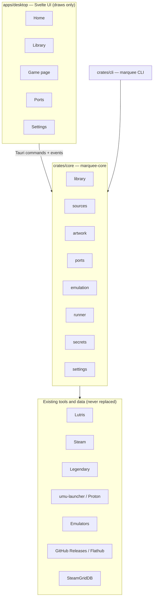
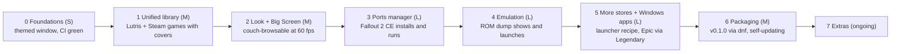

# Marquee — Game Launcher Roadmap

Status: phase 0 (foundations). Last updated 2026-10-20.

## Vision and scope

Marquee (working name) is one console-style launcher for Fedora that shows every game you own — Steam, GOG, Epic, Lutris/Wine apps, emulated games and native decomp/recomp ports — in a single library that looks as good as Steam Big Picture and is driven by mouse or controller.

It is a **front end over existing engines**, not a replacement for them: Lutris, Steam, Legendary and the emulators keep doing installs, Wine/Proton and compatibility. Marquee owns the library, the look, artwork, the ports catalogue and launching.

**Goals**

- One library: every store game Lutris and Steam already know about, plus ports and ROMs, with unified search, filters and favourites.
- Beautiful by default: hero art, logos, blurred backdrops and smooth transitions, pulled automatically for every entry.
- Two modes from one app: Desktop (window, mouse) and Big Screen (fullscreen, controller, 10-foot UI).
- Ports manager: install, update and verify decomp/recomp ports from a catalogue, and check the game files each needs.
- Zero manual setup for things Lutris and Steam already know.

**Non-goals**

- No ROM or game-data downloads. The catalogue points to official port releases only; you supply your own game files.
- Not a Lutris fork: no Wine management, no store login code where Lutris or Legendary already handle it.
- Not cross-platform in v1: Fedora/Linux first; Windows/macOS only if it falls out for free.

## Repository

One public repo holds the app, the core, the CLI and the port catalogue. The catalogue lives in `catalog/` and is published as its own signed `index.json` release asset, so it can update without a new app release. Split it into a separate `marquee-catalog` repo only if it ever needs its own contributors or release cadence.

| Part | Holds | Releases |
| --- | --- | --- |
| App | Tauri app, Rust core crate, CLI, docs, packaging | Tagged app releases: AppImage, RPM, later Flatpak, plus `latest.json` for the auto-updater |
| `catalog/` | One YAML file per port, system definitions for emulators, JSON schema, CI validator | A signed `index.json` rebuilt whenever `catalog/` changes on main |

**Layout**

```
marquee/
  apps/desktop/          Tauri 2 + Svelte 5 + TypeScript (the UI)
    src/                 routes, components, focus engine, theme tokens
    src-tauri/           Tauri shell: commands, gamepad thread, updater (not yet added)
  crates/core/           marquee-core: library DB, sources, launcher, ports, artwork
  crates/cli/            `marquee` CLI over the same core (scripting, tests, debugging)
  catalog/
    ports/               shipwright.yml, zelda64recomp.yml, ...
    systems/             n64.yml, gamecube.yml, ...
    windows/             launcher recipes
    schema/              port.schema.json, system.schema.json
  tools/build-index      validates every catalogue file, checks upstream repos exist, writes index.json
  packaging/             rpm spec, flatpak manifest, .desktop file, icons
  docs/                  ROADMAP.md (this plan), ARCHITECTURE.md, CONTRIBUTING.md
  .github/workflows/     ci.yml, release.yml, catalog.yml
```

**License:** GPL-3.0-or-later, matching Lutris and Heroic. Marquee only calls Lutris's CLI and reads its database, so this is a choice, not an obligation; MIT also works. Catalogue data: CC0 so anyone can reuse it.

**GitHub features to switch on**

- **Actions — `ci.yml`:** on every push, `cargo fmt --check`, `cargo clippy`, `cargo test`, `pnpm lint`, `pnpm test`, and a Tauri debug build on `ubuntu-latest` (Fedora container optional).
- **Actions — `release.yml`:** on a `v*` tag, build AppImage + RPM with `tauri-action`, sign the updater bundle, attach everything to a GitHub Release.
- **Releases:** the app's updater reads `latest.json` from the newest release, so updates are one click and need no server.
- **Issues:** templates for "Broken port", "Missing artwork" and "Bug"; the app's "Report a problem" button opens a pre-filled issue URL, so no token is needed.
- **Projects board:** one board with the phases below as milestones; issues carry the phase label.
- **Renovate or Dependabot:** weekly dependency updates for Cargo and npm.
- **Pages (later):** a small site with screenshots and install instructions.

Workflow: commit straight to main (sole contributor); tags drive releases.

## Architecture

Three layers: a Svelte UI that only draws, a Rust core that knows every source, and the existing tools that actually run games. The UI talks to the core through Tauri commands and events; the CLI uses the same core, so every feature can be tested without the UI.



The app and the CLI share one core; only the bottom layer touches stores, files and emulators.

**Core modules (`marquee-core`)**

| Module | Job |
| --- | --- |
| `library` | SQLite database of unified game entries, search index, favourites, collections, playtime |
| `sources` | One adapter per source behind a `Source` trait: `scan()`, `launch()`, optional `install()` / `uninstall()` |
| `artwork` | Fetch, cache and resize cover, hero, logo and icon images; extract an accent colour per game |
| `ports` | Read the catalogue index, install/update ports from GitHub Releases or Flathub, verify game files |
| `emulation` | System definitions, ROM folder scan, hash identification, emulator command lines |
| `runner` | Start a game, track its process for playtime, report "running" / "exited" to the UI |
| `secrets` | API keys and tokens in the system keyring (GNOME Keyring via Secret Service), never in files |
| `settings` | ROM folders, enabled sources, theme, controller mapping |

**Unified game entry**

| Field | Example |
| --- | --- |
| `id` | `steam:1623730`, `gog:1207658924`, `lutris:purple`, `port:shipwright`, `rom:n64/<sha1>` |
| `title`, `sort_title` | Palworld |
| `platform` | pc-linux, pc-windows, n64, gamecube, ... |
| `source` | steam, gog, epic, lutris, port, rom |
| `installed`, `install_path` | true, `~/Games/ports/shipwright` |
| `launch` | `{kind: "uri", target: "steam://rungameid/1623730"}` or `{kind: "exec", argv: [...]}` |
| `artwork` | local paths for cover, hero, logo, icon + accent colour |
| `playtime_min`, `last_played` | from Steam/Lutris, or tracked by `runner` |
| `tags`, `favorite`, `hidden` | user data, never overwritten by a rescan |

The same game from two sources (for example Fallout on both GOG and Steam) stays two entries, grouped under one title on its game page.

**Storage (XDG paths)**

- Database: `~/.local/share/marquee/library.db`
- Artwork cache: `~/.cache/marquee/art/<id>/` (WebP, resized once)
- Installed ports: `~/Games/ports/<port-id>/`
- Config: `~/.config/marquee/config.toml`

Sources are read-only by default: Marquee never writes to Lutris's or Steam's files, except for the optional Steam-shortcut export in phase 7.

## Integrations

Every source is an adapter that reads what an existing tool already knows; Marquee only adds a store connection where no tool on the machine has one. Order of work: Lutris and Steam first (they already hold most libraries), then ports, emulation, Epic, GOG installs.

| Source | Library from | Launch with | Needs from you | Phase |
| --- | --- | --- | --- | --- |
| Lutris | `~/.local/share/lutris/pga.db` (tables `games`, `service_games`) read-only, plus `lutris --list-games --json` | `lutris lutris:rungame/<slug>` | Nothing | 1 |
| Steam (installed) | `steamapps/libraryfolders.vdf` + `appmanifest_<appid>.acf` (crate `steamlocate`) | `steam steam://rungameid/<appid>` | Nothing | 1 |
| Steam (owned) | Lutris `service_games` now; Steam Web API `GetOwnedGames` later | Install: `steam steam://install/<appid>` | Web API key + SteamID64 (phase 5) | 1 / 5 |
| GOG | Lutris `service_games` | Installed: via Lutris entry; not installed: `lutris lutris:install/<slug>` | Nothing | 1 |
| Ports | catalogue index + `~/Games/ports/` | The port's own binary, AppImage or `flatpak run <id>` | Your game files (ROM, GOG/Steam data) | 3 |
| ROMs | Folders `~/ROMs/<system>/` | Emulator command from the system definition | Your own dumps | 4 |
| Epic | Legendary: `legendary list --json`, `legendary list-installed --json` | `legendary launch <app>` | One-time `legendary auth` login | 5 |
| Windows apps and launchers (Purple, EA App, ...) | Marquee's own prefixes + imported Lutris Wine entries | `umu-run` with GE-Proton in the app's prefix | The installer, or a recipe that downloads it | 5 |
| Heroic (optional) | Heroic's JSON library files under `~/.config/heroic/` | `heroic://launch/...` | Nothing | 5 |
| RomM (optional) | RomM REST API on a self-hosted server | Download ROM, then launch locally | RomM URL + API token | 7 |

Paths for Flatpak installs differ (`~/.var/app/com.valvesoftware.Steam/...`, `~/.var/app/net.lutris.Lutris/...`); every adapter checks both. Verify each command against the tool's current docs when implementing it.

### Steam

- Find Steam with `steamlocate` (native and Flatpak), then read every library folder's `appmanifest_*.acf` for name, size, install state and path.
- Artwork comes free from Steam's CDN per appid: `library_600x900.jpg` (cover), `library_hero.jpg` (hero), `logo.png` (logo), all under `https://cdn.cloudflare.steamstatic.com/steam/apps/<appid>/`. Fall back to SteamGridDB when one is missing.
- Playtime: phase 1 reads Lutris's copy; phase 5 uses `GetOwnedGames` (`playtime_forever`, `rtime_last_played`).
- Steam must already be running for `steam://` URIs to be instant; start it minimised (`steam -silent`) on Marquee launch if the user enables that.

### Lutris

- Open `pga.db` read-only (`?mode=ro`) and watch the file with the `notify` crate, so new Lutris games appear without a restart.
- `games` = entries set up in Lutris (installed or not); `service_games` = full store libraries (GOG, Steam, EGS once synced). Join on `service` + `appid` to mark what is installed.
- Lutris keeps its own playtime and cover art (`~/.local/share/lutris/coverart/`, `banners/`); use them as a fallback.
- If Lutris's Epic source has no synced games, either sync it in Lutris or use Legendary.

### Epic and GOG

- Epic has no public API. Legendary (open source, Python) already handles login, library, install and launch, so Marquee calls it as a subprocess and parses its JSON output.
- Login flow: the app opens Epic's login page in a Tauri window, catches the authorisation code, and passes it to `legendary auth --code <code>`.
- GOG installs stay in Lutris for v1. Native gogdl support (Heroic's downloader) is a later option.

### Windows games and launchers

Marquee replaces the manual Wine setup launchers such as Purple need today: it picks the runtime, prepares the prefix from a recipe, runs the installer, and finds the installed program itself. It cannot fix anti-cheat that blocks Linux; it says so before you try.

**Runtime choice, per game, automatic**

1. Windows game bought on Steam → launch through Steam; Valve picks the Proton version.
2. Native Linux build exists (Baldur's Gate EE, Neverwinter Nights EE, ...) → use it.
3. Everything else → `umu-launcher` with GE-Proton or umu-proton. umu runs Proton outside Steam the way Steam does and applies protonfixes: per-game community fixes looked up by store id in the umu database.

**"Add a Windows app" flow**

1. Pick a known launcher from the recipe list (Purple, EA App, Ubisoft Connect, Battle.net, Rockstar, Amazon Games) or choose any `setup.exe`.
2. Marquee creates `~/Games/<id>/`, picks the Proton version, installs the recipe's winetricks packages (often `corefonts`, `vcrun2022`) and sets its environment variables.
3. The installer runs; you click through its normal setup window. This is the only manual step.
4. Marquee reads the Start Menu shortcuts the installer created inside the prefix (`.lnk` files under `ProgramData/Microsoft/Windows/Start Menu/Programs` and the user's AppData Start Menu) and lists them: tick the one to add.
5. Icon is extracted from the `.exe`; cover and hero art come from SteamGridDB by name.

Where Lutris already has a community install script (EA App, Battle.net, Ubisoft Connect), Marquee can call `lutris lutris:install/<slug>` instead of its own recipe.

**Recipe (in `catalog/windows/`)**

```yaml
id: ncsoft-purple
name: NCSOFT Purple
kind: windows-launcher
installer: { url: <official download URL>, sha256: <optional> }
proton: GE-Proton            # or a pinned version known to work
winetricks: [corefonts, vcrun2022]
env: {}
launch_shortcut: "Purple"    # Start Menu shortcut to add
notes: "Embedded-browser login; anti-cheat depends on the game"
```

**Before launch and after a failure**

- Badges on the game page: ProtonDB tier, anti-cheat status (from the areweanticheatyet.com database), "Needs its own launcher".
- Proton version updates are downloaded in the background; nobody picks Wine versions by hand.
- On a crash: the Proton log is captured and a dialog offers "Try another Proton version", "Reset prefix", "Open ProtonDB", "Report a problem". A version that works is saved for that game.
- Existing Lutris Wine entries (Purple, EA App, Epic launcher) are imported as they are: Marquee reads the prefix and `exe` from `~/.local/share/lutris/games/<slug>.yml`, so nothing is reinstalled.

### Ports catalogue

Each port is one YAML file in `catalog/`; the app downloads the signed `index.json` built from them.

```yaml
id: shipwright
name: Ship of Harkinian
game: The Legend of Zelda: Ocarina of Time
platform: n64
upstream: { github: HarbourMasters/Shipwright }
install:
  kind: github-release        # or: flatpak, tarball, appimage
  asset: "(?i)linux.*\\.zip$"   # regex picked against release assets
  run: soh.appimage
requires:
  - kind: rom
    sha1: [<accepted ROM hashes from the port's docs>]
    place: "oot.z64 next to the binary, or pick it in the port's first-run dialog"
artwork: { steamgriddb: <game id> }
license: CC0-1.0                # the data file; the port keeps its own license
```

- Install: GitHub Releases API `GET /repos/{owner}/{repo}/releases/latest`, pick the asset by regex, download into `~/Games/ports/<id>/`, record tag + SHA-256.
- Update check: compare the stored tag with the latest release, using ETags so checks are free; unauthenticated GitHub allows 60 requests per hour, which is plenty with caching.
- Requirements: hash the ROM or look for the GOG/Steam install, and show "Ready", "Needs your ROM" or "Needs GOG data" on the card.
- First catalogue entries (verify each repo path when adding): Ship of Harkinian, 2Ship2Harkinian, Starship, SpaghettiKart, Zelda64Recomp, sm64coopdx, OpenGOAL, UnleashedRecomp, fallout1-ce, fallout2-ce, OpenJKDF2, UZDoom, OpenMW.

### Port families and install adapters

Most ports come from a few shared frameworks, so Marquee needs one handler per family, not per port. Each family also handles game data the same way, which is what the requirement check has to automate.

| Family | Shared framework | Ports | How your game data gets in |
| --- | --- | --- | --- |
| HarbourMasters | libultraship (LUS) + Torch asset extractor | Ship of Harkinian, 2Ship2Harkinian, Starship, SpaghettiKart | First run asks for the ROM and extracts it into an `.o2r` archive beside the binary |
| N64 recomps | N64Recomp + N64ModernRuntime + RT64 renderer | Zelda64Recomp and newer recomps built on it | Pick the ROM on first launch; mods are `.nrm` files |
| Xbox 360 recomps | XenonRecomp (code) + XenosRecomp (shaders) | UnleashedRecomp | Its installer copies data from your own game files |
| SM64 ports | n64decomp/sm64 decompilation | sm64coopdx, sm64ex, Render96 | ROM extracted at first run or build time |
| OpenGOAL | jak-project (GOAL compiler) | Jak and Daxter, Jak II | Its own launcher extracts your disc image |
| RSDK decomps | Retro Engine v3/v4/v5 | Sonic 1, 2, CD, Mania | `Data.rsdk` from the mobile or Steam versions |
| Engine rewrites | one engine each | fallout1-ce, fallout2-ce, OpenJKDF2, OpenMW, DevilutionX, UZDoom | Point at your GOG or Steam install folder |
| Decomp-only projects | zeldaret/oot, zeldaret/mm, pret/pokeemerald, papermario | none — they rebuild the original ROM | Not playable ports; listed only once a port exists |

**Install adapters (`install.kind` in a port file)**

| Adapter | Used for | What it does |
| --- | --- | --- |
| `github-release` | Most ports | Releases API, picks the asset by regex, unpacks zip/tar, marks AppImages executable, records tag + SHA-256 |
| `flathub` | Ports and emulators on Flathub | `flatpak install --user flathub <id>`; updates with `flatpak update` |
| `archive-url` | Projects outside GitHub (e.g. OldUnreal) | Direct URL + SHA-256 from the catalogue |
| `self-managed` | OpenGOAL | Installs the project's own launcher and lets it manage versions and extraction |
| `build-from-source` | Ports with no binaries (zelda3, sm) | Builds in a Podman container with the toolchain, output into `~/Games/ports/<id>/` |
| `github-nightly` (later) | Ports with CI builds only | GitHub Actions artifacts; needs a token, so optional |

**Data-step handlers (`requires` in a port file)**

- `rom`: hash-check a picked file against the port's accepted versions (ports often support only specific ROM revisions), then copy or link it where the port expects it.
- `store-install`: find the GOG/Steam install of the original game through Lutris or Steam and pass its folder to the port.
- `first-run`: the port extracts data itself (LUS, Zelda64Recomp, OpenGOAL); Marquee just tells you what to pick.

**GitHub adapter details**

- One client for all GitHub calls: ETag caching, a 60 requests/hour budget unauthenticated, 5,000 with an optional token from the keyring.
- Follows renamed or transferred repos (GitHub redirects) and flags archived ones in the UI.
- A weekly Action checks every port's latest release still matches its asset regex and opens an issue when not.

Mods (later, phase 7): Thunderstore for N64 recomp mods and GameBanana for HarbourMasters ports are the usual sources; verify each before integrating.

### Emulation

- System definitions live in the catalogue too: extensions, default emulator, Flatpak id, and the command line, for example `flatpak run org.DolphinEmu.dolphin-emu -b -e {rom}`.
- Scan `~/ROMs/<system>/`, hash each file, and match against libretro-database (MIT-licensed, has No-Intro/Redump hashes) for the correct title.
- Metadata and screenshots: ScreenScraper or IGDB (each needs a free account/API key); artwork from SteamGridDB.

### Artwork

- SteamGridDB API (free key) covers everything Steam's CDN does not: grids (600x900), heroes (1920x620), logos (transparent PNG), icons.
- Pipeline: download once, convert to WebP with the `image` crate, store per game, serve to the UI via Tauri's asset protocol; extract an accent colour for each hero image.
- User override: drop an image on a game page to replace any artwork.

### GitHub

- App updates: Tauri updater plugin reading `latest.json` from the newest GitHub Release (signed).
- Catalogue updates: download the catalogue `index.json` release asset on startup at most once a day; verify its minisign signature.
- Feedback: "Report a problem" opens `https://github.com/<owner>/marquee/issues/new?template=broken-port.yml&title=...` pre-filled with port id, version and log tail.
- Optional token in the keyring raises the API limit to 5,000 requests per hour.

## Visual design

The look is art-led and dark-first: each game's own hero image fills the screen, blurred behind the UI, and its extracted accent colour tints buttons and focus glows. Settle the design in a clickable HTML mock-up before building any screen.

**Screens**

| Screen | What it shows | Key interactions |
| --- | --- | --- |
| Home | Full-bleed hero of the selected game with its logo; rows: Continue playing, Recently added, Ports ready to play, by platform | Left/right moves along a row and swaps the hero; A = play, Y = game page |
| Library | Virtualised cover grid of every entry, sticky filter bar (source, platform, installed, favourites), instant fuzzy search | Type or press a key to search; grid stays 60 fps at 1,000+ covers |
| Game page | Hero banner, logo, Play/Install button, source badge, playtime, last played, screenshots; ports also show requirement status | Play, Install, Update, Open folder, Change artwork, Add to Steam |
| Ports | Store-like catalogue of ports with "Ready", "Needs your ROM", "Update available" badges | Install with progress; a requirements checklist with file pickers |
| Downloads | Queue of port installs and updates with progress and logs | Pause, retry, view log |
| Settings | Connected sources, ROM folders, emulator choices, API keys, theme, controller test | Connect/disconnect a source; rescan |

**Visual language**

- Theme tokens on `:root` (background, surface, text, accent), dark by default with a light theme.
- Backdrop: the selected hero image at 40-60 px blur behind a dark gradient; cross-fades in 250 ms when focus moves.
- Cards: 2:3 covers, 12 px radius, scale to 1.06 and glow in the accent colour on focus.
- Glass panels for overlays (`backdrop-filter: blur`), used sparingly: WebKitGTK renders them on the GPU but heavy stacks drop frames.
- Type: one bundled variable font (Inter or Manrope), large sizes in Big Screen mode; no fonts loaded from the internet.
- Motion: Svelte transitions, every animation under 300 ms, and a "Reduce motion" setting that respects the system preference.
- Optional UI sounds (move, select, back) with a mute toggle.

**Two modes, one codebase**

- Desktop: windowed, mouse and keyboard, denser grid, sidebar navigation.
- Big Screen: fullscreen, controller-first, larger covers and text, no hover states; launched with `marquee --big-screen` or from a Gamescope session.
- Both use the same components with a mode-specific spacing and size scale.

**Controller navigation**

- Read gamepads in Rust with the `gilrs` crate and send events to the UI; don't rely on the browser Gamepad API, which WebKitGTK builds may not enable.
- A small focus engine in the UI (about 200 lines): every focusable element registers its row/column; D-pad and stick move focus spatially, A/B/X/Y map to select/back/context/details.
- Button glyphs switch between Xbox, PlayStation and generic prompts based on the connected controller.
- When a game is running, Marquee hides; a Guide-button chord brings it back.

**Front-end stack**

Svelte 5 + TypeScript + Vite inside Tauri 2; TanStack Virtual for the grid; plain CSS with tokens (or Tailwind if preferred). React with Norigin spatial navigation is the alternative if you prefer React.

## Roadmap

Eight phases; each ends in something you can use, and phase 1 alone already gives you one library of every game you own. Sizes assume evenings and weekends: S = 1 week, M = 2-3 weeks, L = 4+ weeks.



Each box's second line is the gate that closes the phase; the details and checklists follow.

### Phase 0 — Foundations (S)

- [x] Create the GitHub repo, this roadmap as `docs/ROADMAP.md`
- [ ] Pick the license (GPL-3.0 or MIT) and add `LICENSE`; catalogue data CC0
- [ ] Scaffold Tauri 2 + Svelte 5 app and the `core` / `cli` crates in one Cargo workspace
- [ ] `ci.yml` green: fmt, clippy, tests, debug build
- [x] Clickable mock-up of Home, Library and Game page with sample data (`apps/desktop`, runs in a browser); fonts, colours, card size still to settle

**Done when:** `pnpm tauri dev` opens an empty themed window and CI passes on main.

### Phase 1 — Unified library, read-only (M)

- [ ] Library DB + `Source` trait; Lutris adapter (`games` + `service_games`); Steam adapter (installed via `.acf`)
- [ ] Launch through `lutris:rungame/` and `steam://rungameid/`
- [ ] Artwork: Steam CDN for Steam games, Lutris cover art, SteamGridDB for the rest
- [ ] Library grid with search and filters; game page with Play
- [ ] `marquee scan` and `marquee list --json` in the CLI

**Done when:** every GOG + Steam game Lutris knows appears with a cover; a Steam game launches via Steam and a Wine app via Lutris from Marquee.

### Phase 2 — Look and Big Screen (M)

- [ ] Home screen with hero backdrop, logo overlay, accent colours, rows
- [ ] `gilrs` gamepad thread + focus engine; full controller navigation of Home, Library, Game page
- [ ] Big Screen mode, button glyphs, UI sounds, reduce-motion setting
- [ ] Playtime and last-played on cards; favourites and hidden

**Done when:** you can browse and launch any game from the couch without touching a mouse, at a steady 60 fps.

### Phase 3 — Ports manager (L)

- [ ] Catalogue schema + validator + signed `index.json` built from `catalog/`
- [ ] First 5 ports: Ship of Harkinian, Zelda64Recomp, sm64coopdx, fallout2-ce, UZDoom
- [ ] Install, update, uninstall from GitHub Releases and Flathub; downloads screen
- [ ] Requirement checks: ROM hash, GOG/Steam install detection, file pickers

**Done when:** Fallout 2 CE installs, finds your GOG Fallout 2 data, and launches from its card; updates show a badge.

### Phase 4 — Emulation (L)

- [ ] System definitions for NES, SNES, N64, GB/GBC/GBA, DS, GameCube/Wii, PS1, PS2, PSP
- [ ] ROM folder scan, libretro-database identification, per-system emulator choice
- [ ] Launch via Flatpak emulators or RetroArch cores; per-game emulator override

**Done when:** dropping a dump into `~/ROMs/n64/` shows it with the right title and art and it launches in the chosen emulator.

### Phase 5 — More stores and Windows apps (L)

- [ ] Epic via Legendary: login window, library, install, launch
- [ ] Steam Web API: owned-but-not-installed games, playtime
- [ ] umu-launcher runtime: background GE-Proton updates, protonfixes, one prefix per game
- [ ] "Add a Windows app" flow: recipes, winetricks, Start Menu shortcut detection, icon extraction
- [ ] Import existing Lutris Wine entries (Purple, EA App) without reinstalling
- [ ] ProtonDB and anti-cheat badges; crash dialog with Proton switch and prefix reset
- [ ] Optional Heroic import

**Done when:** Purple installs from its recipe with no manual Wine steps, and an Epic game installs and launches without the Epic launcher.

### Phase 6 — Packaging and updates (M)

- [ ] `release.yml`: AppImage + RPM on tag, signed updater bundle
- [ ] In-app update prompt; catalogue auto-refresh
- [ ] RPM repo on Fedora Copr; Flatpak manifest (host access through `flatpak-spawn --host`)

**Done when:** tagging `v0.1.0` produces a release you install with `dnf` and that updates itself.

### Phase 7 — Extras (ongoing)

- [ ] Export any entry to Steam (`shortcuts.vdf`, Steam closed) with its artwork
- [ ] Gamescope session entry so Fedora boots straight into Big Screen
- [ ] Save backups through Ludusavi's CLI
- [ ] RomM connector for a self-hosted ROM library
- [ ] Collections, achievements display, per-game notes

## Risks and open decisions

The biggest risk is scope: keep each phase shippable and resist adding stores or features before phase 2 feels great.

| Risk | Impact | Mitigation |
| --- | --- | --- |
| WebKitGTK drops frames with heavy blur and large grids | Fancy look stutters on the TV | Prototype the hero backdrop + 1,000-cover grid in phase 0; virtualise; one blur layer; "Reduce effects" switch |
| Lutris database schema changes between versions | Library scan breaks after a Lutris update | Read-only, tolerant column lookup; prefer `lutris --list-games --json` where it has the field; test against the installed version (0.5.22) |
| Epic login or API changes | Epic library disappears | Depend on Legendary and update it, never reimplement Epic's API |
| Anti-cheat blocks Linux for a game or MMO | Game installs but never runs | Check the anti-cheat database before install and show "Doesn't run on Linux"; no workarounds |
| Launcher installer URLs or setups change | Windows-app recipe fails | Recipe CI check like ports; fall back to "choose setup.exe" |
| Port release asset names change | Install picks the wrong file or none | Asset regex per port, weekly CI job that checks every port's latest release weekly |
| GitHub API rate limit (60/hour unauthenticated) | Update checks fail | ETag caching, one catalogue fetch per day, optional token |
| Flatpak sandbox blocks launching host apps | Flatpak build can't start Steam/Lutris | Ship RPM/AppImage first; Flatpak uses `flatpak-spawn --host` |
| Legal: catalogue mistaken for a ROM source | Takedowns, bad reputation | Catalogue links only to official port releases; every port lists its game-file requirement; no download links for game data |

**Open decisions**

- [ ] Final name and GitHub owner (personal account or an organisation)
- [ ] Svelte or React for the UI
- [ ] GPL-3.0 or MIT for the app
- [ ] Whether Big Screen mode should also run as a Gamescope session from the login screen

## First week

By the end of the week you should have the repo, a running themed Tauri window, and a CLI that prints your Lutris + Steam library. Commands are for Fedora 44; check Tauri's prerequisites page if a package name has changed.

1. Install the toolchain:

   ```bash
   sudo dnf install webkit2gtk4.1-devel openssl-devel curl wget file \
     libappindicator-gtk3-devel librsvg2-devel libxdo-devel
   sudo dnf group install c-development
   curl --proto '=https' --tlsv1.2 -sSf https://sh.rustup.rs | sh
   sudo dnf install nodejs
   curl -fsSL https://get.pnpm.io/install.sh | sh -
   ```
2. ~~Create the repo~~ (done).
3. Add the Tauri shell to the existing UI: `pnpm tauri init` inside `apps/desktop/` (creates `src-tauri/`).
4. Turn the repo into a Cargo workspace with members `apps/desktop/src-tauri`, `crates/core`, `crates/cli`; add `rusqlite`, `serde`, `steamlocate`, `notify`, `keyring`, `reqwest`, `tokio` to `core`.
5. Write the Lutris adapter first: open `~/.local/share/lutris/pga.db` read-only and print `service_games` grouped by service. Then the Steam `.acf` reader.
6. Add `ci.yml` (fmt, clippy, test, `pnpm build`) and push to main.
7. Get a SteamGridDB API key and store it with `secret-tool store --label=marquee service marquee key steamgriddb`.
8. Make the HTML mock-up of Home, Library and Game page and settle the look.

- [ ] Toolchain installed
- [x] Repo on GitHub
- [ ] `pnpm tauri dev` opens the window
- [ ] `cargo run -p marquee-cli -- list` prints your games
- [ ] CI green
- [ ] Mock-up approved
