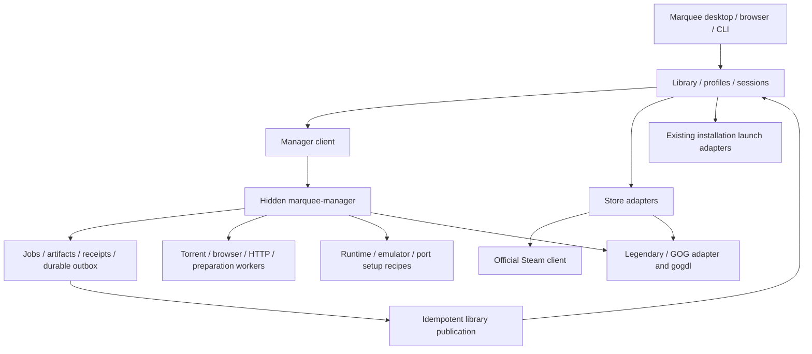

# Marquee roadmap

Updated 2026-10-25. This document owns product priority and milestone status.
[Marquee manager](MARQUEE_MANAGER.md) owns the acquisition architecture and detailed
implementation sequence. Dated feature reports do not override these decisions.

## Product decision

**Marquee is the library and launcher. `marquee-manager` is its hidden local
acquisition/preparation worker.** One normal user interface; a second full app is
not required. Custom FMHY-source/browser/torrent workflows belong behind this
boundary. Closing the launcher should not stop accepted manager jobs; an offline
manager should not break Play for already ready installations.

The 2026-10-22 decision supersedes launcher-owned universal job/process authority
and the previous store-first priority where it conflicts with the manager
foundation. It preserves direct Steam/Epic/GOG integration, managed emulators,
optional legacy bridges and all existing live acceptance requirements. M1/M2 now implement durable local-archive preparation in an independent hidden
worker. New transports, console adapters and a general installer remain open.

Steam keeps its official client for login/install/update/launch. Epic uses a
Legendary-backed store adapter and GOG a direct adapter plus gogdl. Store backends
retain their own capabilities/authentication; the manager can coordinate jobs
without replacing their protocols. Non-Steam runtime setup uses supported managed
umu/Proton recipes. Lutris/Heroic remain optional, never required onboarding.

## Work order

The owner has also scheduled [native streaming](STREAMING.md). ST0 implements a
source-pinned Wolf control adapter and CLI; ST1 now adds a managed local source
build, software/NVIDIA probes and real host lifecycle acceptance. **ST2 tests
Fedora-to-itself streaming over `127.0.0.1`**, first the synthetic stream, then
Sonic/BlastEm in a separate virtual Wayland desktop, received by Moonlight on the
same physical desktop. Pairing, video/audio, streamed input, save restoration and
disconnect/reconnect must pass. A second-device/LAN test is a separate later gate;
local loopback success does not prove network performance. The initial
[Streaming screen](STREAMING_VIEWER.md#streaming-screen) now exposes an existing
local host, pairing, viewer controls and confirmed session stop/revoke on both
surfaces. Host startup automation, edition mapping and an embedded receiver
remain open. This does not mark the existing manager/store
gates complete. Quiver source review/import resumed on 2026-10-25; native recipe work remains separate.

ST2a passed on 2026-10-24: pinned reference receiver installation, pairing and
synthetic sustained video/ticking audio were observed. A source fix removed an
incorrect five-second compositor wait for synthetic apps. ST2b now also passed:
Sonic runs inside Wolf's virtual desktop with user-confirmed video/audio/keyboard
play. Save restoration with both binding sets, controlled receiver-loss/reconnect
to the same process/session, and normal game exit also passed. Subsequent tests
confirmed Alt+Tab without stuck keys, mouse release, the normal disconnect
shortcut and Marquee's owned-viewer disconnect. **Next is ST3 native hosting UI**,
building on this tested keyboard/mouse contract; see the [pilot contract](STREAMING_GAME_PILOT.md).
The owner has no controller yet (2026-10-24). Physical controller acceptance is
deferred until hardware is available and does not block keyboard/mouse UX or ST3.

Native [owned reference viewer](STREAMING_VIEWER.md) groundwork now separates
`view`, `viewer-status` and `disconnect-viewer` from host/game stop. The owner
confirmed focus/key release, mouse release and the disconnect shortcut. Native
disconnect and owner-crash recovery also kept the same running game. This is a separate reference
window controlled by the native CLI; hosting UI and an embedded receiver remain
subsequent increments, not completed by receiver-process ownership.
The OS window-close button and automatic focus return remain tracked separately.

GB/GBC alternative-engine groundwork now implements Mesen/mGBA compatibility,
independent platform defaults and saved game overrides. Mesen remains the default;
explicit unavailable selections do not silently switch save directories. mGBA’s
existing source recipe registers a GB/GBC runner. Live GB/GBC acceptance, GBA
import and streamed profiles remain open; see [emulators](EMULATORS.md#gbgbc-engine-selection).

The owner's follow-on tracks are [collection-driven emulator expansion](EMULATOR_EXPANSION.md)
and [soundtracks/player](SOUNDTRACKS.md). Validate the already installed lightweight
runners after Sonic streaming; then fill Neo Geo Pocket and useful alternative
runner gaps. Music starts with local attachments/player, then metadata discovery,
Jellyfin and reviewed acquisition. These are scheduled increments, not implemented
capabilities or reasons to delay the active streaming audio/input gates.

| Order | Increment | Completion gate |
| --- | --- | --- |
| Done: local slice | M0/M1 — Contract/storage slice and archive preparation | Reviewed ZIP/7z/RAR plan → receipt → transactional library registration; recovery tests and real Genesis browser registration passed; see [intake](INTAKE.md) |
| Done: local worker | M2 — Hidden `marquee-manager` process | Worker/socket/ownership tests and real browser close/reconnect passed; immutable outputs, safe receipt publication and M1 cutover; see [manager](MARQUEE_MANAGER.md) |
| Done: torrent/browser slice | M3/M4 — Existing torrent and browser workers | Manager hosts torrents and browser jobs with linked archive reviews/receipts; live-provider, unsupported-package and packaged delivery remain open |
| 4 | M5 — Added console collection | Read-only inventory can start now; platform recipes follow the common preparation contract and pass their own gates |
| 5 | S1 — Direct Steam | Persistent installed library and real launch first; owned sync and explicit installation handoff complete the milestone |
| 6 | C1 + E1 — Compatibility and Epic | One tested managed Windows runtime/prefix path plus direct account/library/install/play through Legendary |
| 7 | G1 — Direct GOG | Direct account/library, supported gogdl operations and native/Windows install/play |
| 8 | U1 and M6 continuation | Unified identities/defaults, remaining setup-worker migration, save/controller polish and packaging |
| Active streaming track | ST2 acceptance / ST3 groundwork | Keyboard/mouse focus, save restore, explicit viewer disconnect/reconnect and exit passed; native viewer owner implemented; hosting UI next, controller deferred for hardware; [ST2 acceptance](STREAMING.md#st2--fedora-to-itself-streaming) |

[Manager M0–M6](MARQUEE_MANAGER.md#implementation-sequence-and-gates) supplies
concrete deliverables and recovery acceptance. M3/M4 are independent after M2;
do not block one on every provider in the other. Read-only console inventory and
Steam discovery may proceed alongside the foundation. Console support ships one
validated format/title path at a time, not as a prerequisite to every store flow.
The store sequence remains Steam → compatibility/Epic → GOG; optional enrichment and a separate manager UI remain deferred. Quiver Q0/Q1 now adds local app-list discovery, not another installation authority.

[PS3 integration](PS3.md) now includes read-only discovery, pinned reviewed
firmware installation, verified ISO registration, linked Media and direct RPCS3
ISO launch with session tracking. The supplied God of War III archive was
explicitly unpacked and its BCUS98111 ISO registered; the first managed launch
selected Vulkan on the RTX 5090. Live menu/video/audio/keyboard-navigation and clean exit/return passed. In-game play, native saves, relaunch persistence and streaming acceptance remain open. General archive preparation, PKG and
license import remain future work. Discovery never extracts or launches content.

## Current implementation versus target

| Area | Current evidence and remaining boundary |
| --- | --- |
| Shared application | Rust core/CLI, Tauri/Svelte desktop, authenticated loopback browser surface and event hub; separate `marquee-manager` process, shared `marquee-media` helpers and a library-only receipt consumer |
| Library and sessions | PS1/PS2 disc adapters, persistent sessions/recovery, stable user metadata and scan diagnostics; normalized game/edition/install/profile model remains incremental work |
| Other integrated systems | DS, Genesis, Neo Geo and generic cartridge/disc adapters; Sonic 2 has a title-specific live keyboard/audio/save-state/exit pass under native Wayland; [emulator matrix](EMULATORS.md) owns exact coverage and live limits |
| Emulator/port lifecycle | Catalogue installs, five native-port recipes, reviewed pinned source builds, staged updates and rollback; installed program is not validated game data |
| Archive preparation | M1 persistent explicit-platform reviews/jobs/receipts, isolated directory promotion, transactional registration and restart recovery; legacy immediate batches remain available. Independent worker is implemented; universal transport registry and unsupported package recipes remain open |
| Torrents | Durable history, reviewed files/magnets, private/public separation, retained sources, pause/resume and scan recovery; hosted by the detached manager with backed-up single-owner adoption and no-UI checkpoints; linked archive/platform reviews and immutable source-bearing receipts implemented; real 13.58 GB receive-only PS4 transport passed, package installation remains unsupported |
| Browser/provider work | Opt-in companion → manager job authority, stable replay, attribution, progress/hash history and acknowledged cancellation; Atomic linked platform review and provenance-bearing preparation/library receipts verified with synthetic UI and recovery tests. Legacy completion adoption, live provider-to-install/launch acceptance, reference hashes and packaged delivery remain open |
| Added console games | Owner reports Switch, PS3, PS4, Xbox and Xbox 360 additions; RPCS3/shadPS4/xemu tools exist; PS3 read-only archive/folder discovery and reviewed firmware setup implemented, RPCS3 direct ISO Library Play implemented; no Play adapters for the other four systems. [Console plan](CONSOLE_PREPARATION.md) owns gaps |
| Stores | Read-only installed Steam detection/manifests implemented; persistent library/launch and complete Steam/Epic/GOG workflows remain open |
| Streaming | Native Wolf API/build/probes and owned reference viewer open/status/disconnect; Sonic video/audio/keyboard, saves, focus/key release, mouse release and disconnect/reconnect passed. Hosting lifecycle/UI, embedded player, OS window-close/automatic focus return, deferred controller and second-device gates remain open; [streaming gates](STREAMING.md) |
| Compatibility | Narrow Purple/Aion 2 setup/open recipe with checkpoints/cancellation; live game compatibility and general runtime lifecycle remain open |
| UI/metadata | Unified-library presentation, installation distinctions, catalogue provenance and optional artwork/facts; UI grouping is not a completed normalized backend |
| Legacy bridges | Explicit opt-in read-only Lutris cache bridge, external shortcuts; not a direct account or store integration |

## Architecture and ownership

The library remains sole writer of `library.db`; the manager owns separate state.
Manager receipts wait durably while the launcher is closed. Adapters declare real
capabilities: a delegated client handoff is not measured download completion,
browser completion is not a torrent event, and a package is not an installation.
See [manager contracts](MARQUEE_MANAGER.md) rather than duplicating schemas here.

## Store milestones retained

[Store implementation handoff](STORE_INTEGRATION.md) owns detailed checklists.

- **S1:** persist native/Flatpak Steam inventory without damaging existing entries;
  show installed games and launch through the selected client; reconcile install
  handoffs; add authorized owned-library access with honest offline/credential
  states. Do not count a URI helper's lifetime as playtime.
- **C1/E1:** pin helpers/runtime, isolate prefixes, preserve saves, apply tested
  dependency recipes and support direct Epic connection/library/install/update/
  launch. Unsupported pause/resume or authentication operations stay explicit.
- **G1:** verify gogdl capabilities, implement account/library gaps, native/Windows
  selection and the same job/receipt/readiness contract. No Lutris prerequisite.
- **U1:** persist game/edition/product/install/profile relationships incrementally;
  retain favorites, titles, preferred profiles, entitlements and independent saves.
  Never merge editions or store products by title alone.

## Acceptance and deferred work

Keep these open until observed; fixture/demo success does not close them:

- PS1/PS2 real boot/input/save/exit/return and session accounting; [PS1](PS1.md),
  [PS2](PS2.md), [correction history](CORRECTIONS.md).
- Additional emulator controller/save behavior, complete Neo Geo set validation,
  firmware installation and runner-specific isolation; [emulators](EMULATORS.md),
  [controllers](CONTROLLERS.md), [console preparation](CONSOLE_PREPARATION.md).
- Purple sign-in/gameplay; [Purple](PURPLE.md).
- Native picker/drop, Tauri/controller focus, real-collection performance and game
  return; [UI](UI_UX.md), [rendering](DESKTOP_RENDERING.md).
- Torrent external interoperability, multi-machine/large-transfer interruption,
  source retention and private/public policy through manager migration;
  [torrents](TORRENTS.md).
- Browser restart/attribution, native-host packaging and supported browser delivery;
  [scraper integration](https://github.com/artsiom-tsaryonau/fmhy-marquee-scrapers/blob/main/docs/MARQUEE_INTEGRATION.md).

Continue [OpenGOAL/unified library](UNIFIED_LIBRARY.md) and
[platform expansion](EXPANSION_CATALOGUE.md) against these contracts. [Quiver Q0/Q1](QUIVER_INTEGRATION.md) now supports reviewed local-list discovery; installation pilots remain Q2. Artwork/enrichment never gates Play.
Separate manager UI, remote/NAS service, universal installer, additional providers
and advanced collections are later work. Native streaming now has its own
owner-scheduled [implementation track](STREAMING.md).

## Verification and handoff

For implementation, record exact build/helper/recipe, environment, tests and live
scenarios. Inspect actual schema versions before migration; v4–v6 are allocated.
Preserve current IDs, data paths, firmware, sources, saves and user edits. Never
reset another contributor's changes. Follow the manager cutover/rollback plan.

Run relevant Rust/UI checks (`scripts/check.sh` for broad implementation work),
plus process/packaging acceptance when introducing the worker. Documentation-only
changes require local link, authority/consistency and whitespace checks. This
planning update starts no jobs and changes no runtime behavior.

## Lightweight emulator acceptance — 2026-10-24

The existing managed Mesen adapter passed local video/audio/keyboard acceptance
for Alter Ego (NES) and Uwol: Quest for Money (SNES). SNES state restoration and
normal File → Exit also passed. [The acceptance report](MESEN_ACCEPTANCE.md)
records title-specific evidence, an earlier unexplained SNES termination, and
remaining native-save, streamed-profile and hardware-controller gates. Next is
a Mesen virtual-desktop streaming profile, then the GB/GBC/PCE collection cohort;
no additional engine download is needed for these systems.

## Soundtrack foundation — 2026-10-24

The player now centers its utility popovers on one row, OST removes the redundant
footer note/padding, and the navigation rail is flush to the window edge. Ports
are tagged game entries/filter results, with setup kept in Tools and no separate
Ports screen. Metadata IDs no longer appear conditionally in installation facts.

Game details now split Overview / OST / Media / Metadata, with installation and identity
information on the right, Edit at the top right, direct emulator settings and
no duplicate Overview shortcut panel. The desktop rail reaches the bottom behind
the player overlay. These changes remain subject to native visual acceptance.

The library now offers saved platform shelves or a flat grid; mixed Home shelves
keep chronological ordering and a shared image height with native image widths.
Aircloud Color adapts the dashboard's panel/control hierarchy with brighter
Marquee accents, with Classic available in Appearance. These presentation
choices preserve canonical game IDs and independent music preferences.

The game-page layout now uses a Steam-inspired media stage/thumbnail strip,
adjacent release summary and a Play/activity toolbar, followed by Overview / Media / Metadata. Media groups Soundtrack, Images and Videos.
Only available assets are shown, with contained box art when that is the only
image. Prices, purchase panels and review sections are outside this launcher UI.

The artwork slice now imports embedded music visuals or chosen local JPEG/PNG
images, with bounded decoding and persistent source labels. Explicit game links
provide a labelled fallback image across Music and OST views. Genesis joins the
existing CRC/No-Intro/libretro artwork path, and game details prioritize artwork,
play activity and library actions over technical identification. This does not
complete online release matching, text-tag metadata or rich game descriptions.

The first global Music destination now browses/searches saved albums independently
of games. Queue inspection, play-next/append and upcoming-track reorder/removal
are implemented, with session-only state. The shared shell now uses a measured,
full-width player footer; Add games lives in the Games header and Big Screen in
the top-right desktop toolbar. Native/responsive acceptance remains open.

Local game extras now have a **Media** navigation destination and a game-page
**Media** tab: independent collections, explicit game links, selected-file/disc
imports, image gallery, visible Marquee video controls, advisory spoiler badges and persisted resume.
[Media usage and GoW3 acceptance](MEDIA_LIBRARY.md#local-game-extras--current-use-and-limits)
record the actual pilot and limits. Raw M2V conversion/audio pairing, generated
video posters and remote hosting remain separate steps.

The selected product direction is a **Marquee-hosted remote media library**,
starting with music. The [media library roadmap](MEDIA_LIBRARY.md) sequences
global browsing/queue, metadata/artwork, authenticated hosting, direct remote
playback and explicit session/output control. Optional Jellyfin connection is
a provider path. Streaming the whole launcher remains a separate delivery path.
The current music endpoint is local-only and is not a remote-account service.

Music now has a saved accent separate from game Play, round 48 px play controls,
consistent secondary controls and title/album/duration song columns. Bounded
header probes cache real track durations; unknown duration never blocks playback.

The player controls now use a central play/pause transport, track-row controls,
seek/volume sliders and quieter options menus. Current-track pause/resume keeps
position. **This device** identifies the current local output; streamed launcher
music is a [separate hosting/routing gate](STREAMING.md#launcher-music-and-media-streaming).
Plan a reviewed **Stream Marquee** desktop session before claiming that remote
clients receive its OST audio. Audio-only client playback remains another track.

Game details now have an **OST** tab with named albums, source attribution,
local audio import, explicit reusable links and a persistent compact player.
Audio uses separate records and copied media; game scanning and acquisition
remain independent. Tests cover persistence, pause/queue races and track-scoped
HTTP seek access. Live WebKit/browser decoding and visual acceptance remain open.
The [soundtrack guide](SOUNDTRACKS.md) owns usage, limits and MU0–MU5 gates.
yt-dlp acquisition, Jellyfin and automatic matching remain later work; the source
search link is not a downloader.

The [YouTube OST pilot](YOUTUBE_OST.md) now tests the owner's selected Sonic 2
playlist without browser cookies. Reuse the companion's paired bridge for a
typed music URL handoff, then add reviewed durable manager download/audio jobs.
Keep cookies an explicit optional fallback, separate from the existing
Vimm/Axekin game-provider protocol and music playback.

Metadata search now starts with an explicit SteamGridDB artwork-identity review
on the game Metadata tab. Search results are capped and kept in edition-bound,
30-minute server reviews. Applying one stores provider attribution and artwork
without renaming, changing platform or merging games. Live GoW3 original versus
Remastered candidates were checked. Text descriptions, richer release matching,
provider/platform disambiguation and additional providers remain open.

### Reviewed game details search — implemented 2026-10-25

Metadata now offers platform-scoped TheGamesDB search alongside the existing
SteamGridDB artwork search. Release previews and explicit apply fill missing
facts without replacing existing values or changing game identity/files.
The real PS3 search/apply and responsive UI were verified in an isolated library.
Richer developer/publisher mapping and region/serial exact matching remain open.

### YouTube soundtrack discovery — implemented 2026-10-25

Game → Media → Soundtrack → Find soundtrack searches playlists or videos through
a pinned, verified, cookie-free yt-dlp helper. Playlist previews show up to 50
track entries. Linking creates or reuses a source album and preserves its existing
metadata; it does not download audio or create remote-playable tracks. The owner’s
existing locally attached Sonic 2 album is unaffected. Durable acquisition,
per-track progress/cancel/retry and verified importer handoff remain the next
music-manager step. See [YouTube integration](YOUTUBE_OST.md).

### Portable installation packages — proposed 2026-10-25

[Portable packages](PORTABLE_PACKAGES.md) should transfer immutable prepared game
payloads and reviewed runtime requirements between Marquee instances, preserving
separate saves and host settings. MP0–MP3 define manifest, local export/import,
cross-instance acceptance and later private transfer. This is planned work, not
native PS3 conversion or an implemented package format.

The owner also resumed [Quiver integration](QUIVER_INTEGRATION.md). Q0 now pins
upstream, retains notices and defines existing/new Linux port fixtures. Q1 now provides bounded local-file preview, selected import, stable source-scoped identities and existing-recipe mappings through Tools, shared APIs and CLI. Q2 native install/setup/launch acceptance remains next; hosted-catalogue mirroring and unattended installs are outside this slice.

Quiver Q2a now adds a pinned 2 Ship 2 Harkinian engine recipe, explicit canonical
repository alias handling and discovery-to-recipe navigation. Isolated engine
installation, executable integrity repair and settings preservation passed.
This uses the existing foreground installer; durable manager jobs, actual ROM
setup, native saves and gameplay/relaunch acceptance remain open. No game data
was downloaded or an engine launched by this installation-only test.

## Current owner priority: decomps, PS4 and PS5 (2026-10-25)

1. **Native engines — durable foundation implemented.** Q2b moves shipped port
   installation into the existing manager: close/reconnect, progress, cancellation,
   interrupted retry, immutable receipts and user-file preservation tested with
   pinned 2 Ship. Game-data setup and tracked play remain open. The supplied
   Ocarina of Time archive is PAL 1.1 and matches the pinned Shipwright 9.3.1
   supported list. Manager installation, isolated asset setup and menu/file-select
   arrival passed; gameplay, native save and relaunch remain under acceptance.
2. **PS4 — one supported base-game path.** Audit the installed versus current
   shadPS4 core/launcher contract, inspect the actual retained input, identify
   base/update requirements and prerequisites, then implement reviewed preparation,
   stable saves/configuration and one library launch adapter. The prior PS4 torrent
   receive test is transport evidence only. Do not label a PKG download playable.
3. **PS5 — a separate KytyPS5 pilot.** Check the modern `KytyPS5/KytyPS5` Linux
   build and title-specific requirements; do not substitute the older InoriRus
   Kyty project's limitations. Add inspection, reviewed preparation and a launch
   adapter only for an actual supported input, then observe gameplay, saves and
   clean exit. Compatibility remains title/build-specific.
4. **Portable installations and streaming.** Start portable transfer with a small
   accepted installation; reuse preparation/receipt contracts for later ports and
   consoles. Extend streaming only after each local adapter is accepted.

Upstream direction checked against [shadPS4](https://github.com/shadps4-emu/shadPS4)
and [KytyPS5](https://github.com/KytyPS5/KytyPS5). Their current documentation
supports Linux and reports game-specific progress; neither implies that the
existing Marquee managed-tool entries already provide game import or Play.

Discovery now has a concrete UI slice: Games → Discover games → Native games &
ports supports searching six shipped recipes, saving projects without downloads,
reviewing requirements and starting existing durable installs. Broader online
Quiver/provider search and cached sources remain next; local app-list import is
not equivalent to the full hosted catalogue. See [Q1b](QUIVER_INTEGRATION.md).

PS4/PS5 now have bounded read-only inspectors and Tools/CLI exposure. The supplied
PS5 Demon's Souls RAR contains a prepared-folder candidate, with 223,257 files and
87.2 GB declared output. PS4 base/update/DLC identities were read from metadata.
Preparation, game registration and launch remain separate gates.

### 2026-10-25 collection follow-up

- Xenia Canary: official Linux build pinned and managed install/Open available;
  Xbox-family RAR header inspection exposed under xemu/Xenia. Xbox 360 library
  import/Play is still open. Next: verify the retained Vanquish ISO and implement
  its preparation, launch, keyboard mapping and save/relaunch acceptance; see
  [console preparation](CONSOLE_PREPARATION.md#xbox-family-inspection-and-xenia-runtime-2026-10-25).
- Quiver: Games discovery now links to the actual hosted community catalogue;
  local lists and reviewed recipes work. Hosted in-app search is still pending.
- Main-library enrichment: reviewed missing facts added for God of War III,
  Vice City and Metal Gear Solid. God of War III has a Sony OST source-only album;
  no new audio download. [Evidence and remaining media work](YOUTUBE_OST.md#additional-library-enrichment-2026-10-25).
