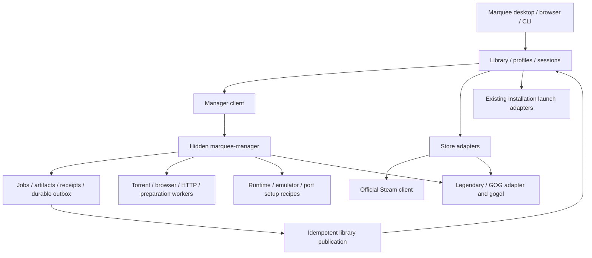

# Marquee roadmap

Updated 2026-10-23. This document owns product priority and milestone status.
[Marquee manager](MARQUEE_MANAGER.md) owns the acquisition architecture and detailed
implementation sequence. Dated feature reports do not override these decisions.

## Product decision

**Marquee is the library and launcher. `marquee-manager` is its hidden local
acquisition/preparation worker.** One normal user interface; a second full app is
not required. Custom FMHY-source/browser/torrent workflows belong behind this
boundary. Closing the launcher should not stop accepted manager jobs; an offline
manager should not break Play for already ready installations.

The 2026-10-22 decision supersedes launcher-owned universal job/process authority
and the previous store-first priority where it conflicts with the manager
foundation. It preserves direct Steam/Epic/GOG integration, managed emulators,
optional legacy bridges and all existing live acceptance requirements. M1/M2 now implement durable local-archive preparation in an independent hidden
worker. New transports, console adapters and a general installer remain open.

Steam keeps its official client for login/install/update/launch. Epic uses a
Legendary-backed store adapter and GOG a direct adapter plus gogdl. Store backends
retain their own capabilities/authentication; the manager can coordinate jobs
without replacing their protocols. Non-Steam runtime setup uses supported managed
umu/Proton recipes. Lutris/Heroic remain optional, never required onboarding.

## Work order

The owner has also scheduled [native streaming](STREAMING.md). ST0 implements a
source-pinned Wolf control adapter and CLI; ST1 now adds a managed local source
build, software/NVIDIA probes and real host lifecycle acceptance. **Next is ST2:
Fedora-to-itself streaming over `127.0.0.1`**, first the synthetic stream, then
Sonic/BlastEm in a separate virtual Wayland desktop, received by Moonlight on the
same physical desktop. Pairing, video/audio, streamed input, save restoration and
disconnect/reconnect must pass. A second-device/LAN test is a separate later gate;
local loopback success does not prove network performance. Hosting UI and an
embedded receiver remain open. This does not mark the existing manager/store
gates complete or restart the deferred Quiver work.

ST2a passed on 2026-10-24: pinned reference receiver installation, pairing and
synthetic sustained video/ticking audio were observed. A source fix removed an
incorrect five-second compositor wait for synthetic apps. ST2b now also passed:
Sonic runs inside Wolf's virtual desktop with user-confirmed video/audio/keyboard
play. Save restoration with both binding sets, controlled receiver-loss/reconnect
to the same process/session, and normal game exit also passed. **Next is remaining
ST2c keyboard/mouse focus and ordinary viewer-disconnect semantics**, then native
hosting integration; see the [pilot contract](STREAMING_GAME_PILOT.md).
The owner has no controller yet (2026-10-24). Physical controller acceptance is
deferred until hardware is available and does not block keyboard/mouse UX or ST3.

The owner's follow-on tracks are [collection-driven emulator expansion](EMULATOR_EXPANSION.md)
and [soundtracks/player](SOUNDTRACKS.md). Validate the already installed lightweight
runners after Sonic streaming; then fill Neo Geo Pocket and useful alternative
runner gaps. Music starts with local attachments/player, then metadata discovery,
Jellyfin and reviewed acquisition. These are scheduled increments, not implemented
capabilities or reasons to delay the active streaming audio/input gates.

| Order | Increment | Completion gate |
| --- | --- | --- |
| Done: local slice | M0/M1 — Contract/storage slice and archive preparation | Reviewed ZIP/7z/RAR plan → receipt → transactional library registration; recovery tests and real Genesis browser registration passed; see [intake](INTAKE.md) |
| Done: local worker | M2 — Hidden `marquee-manager` process | Worker/socket/ownership tests and real browser close/reconnect passed; immutable outputs, safe receipt publication and M1 cutover; see [manager](MARQUEE_MANAGER.md) |
| 3 | M3/M4 — Existing torrent and browser workers | Adopt state safely; downloaded bytes reach supported preparation without a manual second importer; transport-specific capabilities remain truthful |
| 4 | M5 — Added console collection | Read-only inventory can start now; platform recipes follow the common preparation contract and pass their own gates |
| 5 | S1 — Direct Steam | Persistent installed library and real launch first; owned sync and explicit installation handoff complete the milestone |
| 6 | C1 + E1 — Compatibility and Epic | One tested managed Windows runtime/prefix path plus direct account/library/install/play through Legendary |
| 7 | G1 — Direct GOG | Direct account/library, supported gogdl operations and native/Windows install/play |
| 8 | U1 and M6 continuation | Unified identities/defaults, remaining setup-worker migration, save/controller polish and packaging |
| Active streaming track | ST2 — Same-machine Fedora pilot | Synthetic/Sonic video/audio/keyboard, save restore, controlled receiver-loss/reconnect and normal game exit passed; focus and ordinary viewer-disconnect semantics next; controller acceptance deferred for hardware; [ST2 acceptance](STREAMING.md#st2--fedora-to-itself-streaming-next) |

[Manager M0–M6](MARQUEE_MANAGER.md#implementation-sequence-and-gates) supplies
concrete deliverables and recovery acceptance. M3/M4 are independent after M2;
do not block one on every provider in the other. Read-only console inventory and
Steam discovery may proceed alongside the foundation. Console support ships one
validated format/title path at a time, not as a prerequisite to every store flow.
The store sequence remains Steam → compatibility/Epic → GOG; Quiver, optional
enrichment and a separate manager UI remain deferred.

## Current implementation versus target

| Area | Current evidence and remaining boundary |
| --- | --- |
| Shared application | Rust core/CLI, Tauri/Svelte desktop, authenticated loopback browser surface and event hub; separate `marquee-manager` process, shared `marquee-media` helpers and a library-only receipt consumer |
| Library and sessions | PS1/PS2 disc adapters, persistent sessions/recovery, stable user metadata and scan diagnostics; normalized game/edition/install/profile model remains incremental work |
| Other integrated systems | DS, Genesis, Neo Geo and generic cartridge/disc adapters; Sonic 2 has a title-specific live keyboard/audio/save-state/exit pass under native Wayland; [emulator matrix](EMULATORS.md) owns exact coverage and live limits |
| Emulator/port lifecycle | Catalogue installs, five native-port recipes, reviewed pinned source builds, staged updates and rollback; installed program is not validated game data |
| Archive preparation | M1 persistent explicit-platform reviews/jobs/receipts, isolated directory promotion, transactional registration and restart recovery; legacy immediate batches remain available. Independent worker is implemented; universal transport registry and unsupported package recipes remain open |
| Torrents | Durable history, reviewed files/magnets, private/public separation, retained sources, pause/resume and scan recovery; hosted by the detached manager with backed-up single-owner adoption and no-UI checkpoints; linked archive/platform reviews and immutable source-bearing receipts implemented; real 13.58 GB receive-only PS4 transport passed, package installation remains unsupported |
| Browser/provider work | Opt-in companion → manager job authority, stable replay, attribution, progress/hash history and acknowledged cancellation; Atomic linked platform review and provenance-bearing preparation/library receipts verified with synthetic UI and recovery tests. Legacy completion adoption, live provider-to-install/launch acceptance, reference hashes and packaged delivery remain open |
| Added console games | Owner reports Switch, PS3, PS4, Xbox and Xbox 360 additions; RPCS3/shadPS4/xemu tools exist, no library descriptors/adapters for the five systems. [Console plan](CONSOLE_PREPARATION.md) owns gaps |
| Stores | Read-only installed Steam detection/manifests implemented; persistent library/launch and complete Steam/Epic/GOG workflows remain open |
| Streaming | Native Wolf API controls, local source build, image/rollback receipts and software/NVIDIA probes; real API/start/stop/restart passed. Automatic hosting lifecycle, UI, embedded player and end-to-end streaming acceptance remain open; [streaming gates](STREAMING.md) |
| Compatibility | Narrow Purple/Aion 2 setup/open recipe with checkpoints/cancellation; live game compatibility and general runtime lifecycle remain open |
| UI/metadata | Unified-library presentation, installation distinctions, catalogue provenance and optional artwork/facts; UI grouping is not a completed normalized backend |
| Legacy bridges | Explicit opt-in read-only Lutris cache bridge, external shortcuts; not a direct account or store integration |

## Architecture and ownership

The library remains sole writer of `library.db`; the manager owns separate state.
Manager receipts wait durably while the launcher is closed. Adapters declare real
capabilities: a delegated client handoff is not measured download completion,
browser completion is not a torrent event, and a package is not an installation.
See [manager contracts](MARQUEE_MANAGER.md) rather than duplicating schemas here.

## Store milestones retained

[Store implementation handoff](STORE_INTEGRATION.md) owns detailed checklists.

- **S1:** persist native/Flatpak Steam inventory without damaging existing entries;
  show installed games and launch through the selected client; reconcile install
  handoffs; add authorized owned-library access with honest offline/credential
  states. Do not count a URI helper's lifetime as playtime.
- **C1/E1:** pin helpers/runtime, isolate prefixes, preserve saves, apply tested
  dependency recipes and support direct Epic connection/library/install/update/
  launch. Unsupported pause/resume or authentication operations stay explicit.
- **G1:** verify gogdl capabilities, implement account/library gaps, native/Windows
  selection and the same job/receipt/readiness contract. No Lutris prerequisite.
- **U1:** persist game/edition/product/install/profile relationships incrementally;
  retain favorites, titles, preferred profiles, entitlements and independent saves.
  Never merge editions or store products by title alone.

## Acceptance and deferred work

Keep these open until observed; fixture/demo success does not close them:

- PS1/PS2 real boot/input/save/exit/return and session accounting; [PS1](PS1.md),
  [PS2](PS2.md), [correction history](CORRECTIONS.md).
- Additional emulator controller/save behavior, complete Neo Geo set validation,
  firmware installation and runner-specific isolation; [emulators](EMULATORS.md),
  [controllers](CONTROLLERS.md), [console preparation](CONSOLE_PREPARATION.md).
- Purple sign-in/gameplay; [Purple](PURPLE.md).
- Native picker/drop, Tauri/controller focus, real-collection performance and game
  return; [UI](UI_UX.md), [rendering](DESKTOP_RENDERING.md).
- Torrent external interoperability, multi-machine/large-transfer interruption,
  source retention and private/public policy through manager migration;
  [torrents](TORRENTS.md).
- Browser restart/attribution, native-host packaging and supported browser delivery;
  [scraper integration](https://github.com/artsiom-tsaryonau/fmhy-marquee-scrapers/blob/main/docs/MARQUEE_INTEGRATION.md).

Continue [OpenGOAL/unified library](UNIFIED_LIBRARY.md) and
[platform expansion](EXPANSION_CATALOGUE.md) against these contracts. Quiver remains
[planning only](QUIVER_INTEGRATION.md). Artwork/enrichment never gates Play.
Separate manager UI, remote/NAS service, universal installer, additional providers
and advanced collections are later work. Native streaming now has its own
owner-scheduled [implementation track](STREAMING.md).

## Verification and handoff

For implementation, record exact build/helper/recipe, environment, tests and live
scenarios. Inspect actual schema versions before migration; v4–v6 are allocated.
Preserve current IDs, data paths, firmware, sources, saves and user edits. Never
reset another contributor's changes. Follow the manager cutover/rollback plan.

Run relevant Rust/UI checks (`scripts/check.sh` for broad implementation work),
plus process/packaging acceptance when introducing the worker. Documentation-only
changes require local link, authority/consistency and whitespace checks. This
planning update starts no jobs and changes no runtime behavior.
