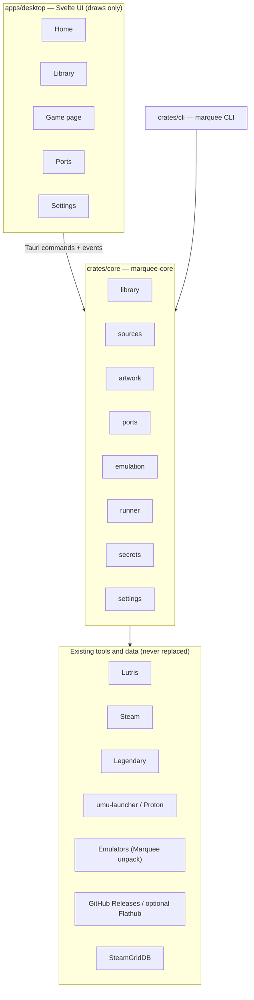

# Marquee — Game Launcher Roadmap

Status: **phase 0 mostly closed** (native window opens; MIT license added), plus an **out-of-sequence PS2 slice** coded 2026-10-20. Last updated 2026-10-20.

This roadmap is still the long-term plan (Lutris/Steam first in phase 1). Work actually landed is tracked in [PS2.md](PS2.md). Do not start Steam/Lutris adapters or [PS2_METADATA_FOLLOWUP.md](PS2_METADATA_FOLLOWUP.md) until the PCSX2 launch/exit gate there is closed.

**Current implementation milestone (ahead of phase 1):** solidify the offline PS2 core and desktop app (library, **Marquee-managed PCSX2 unpack**, covers, sessions, UI chrome). **Live PCSX2 Play → quit → duration is pending.** See [PS2.md](PS2.md).

Integration candidates and detailed collection proposals: [EXPANSION_CATALOGUE.md](EXPANSION_CATALOGUE.md).

## Vision and scope

Marquee (working name) is one console-style launcher for Fedora that shows every game you own — Steam, GOG, Epic, Lutris/Wine apps, emulated games and native decomp/recomp ports — in a single library that looks as good as Steam Big Picture and is driven by mouse or controller.

It is a **front end over existing engines**, not a replacement for them: Lutris, Steam and Legendary keep doing installs, Wine/Proton and compatibility. **Emulator binaries are Marquee-managed** (official builds unpacked into the data dir; PCSX2 is the first). BIOS, firmware and game files stay user-supplied. Marquee owns the library, the look, artwork, the ports catalogue and launching.

**Goals**

- One library: every store game Lutris and Steam already know about, plus ports and ROMs, with unified search, filters and favourites.
- Beautiful by default: hero art, logos, blurred backdrops and smooth transitions, pulled automatically for every entry.
- Two modes from one app: Desktop (window, mouse) and Big Screen (fullscreen, controller, 10-foot UI).
- Ports manager: install, update and verify decomp/recomp ports from a catalogue, and check the game files each needs.
- Zero manual setup for things Lutris and Steam already know.

**Non-goals**

- No ROM or game-data downloads. The catalogue points to official port releases only; you supply your own game files.
- Not a Lutris fork: no Wine management, no store login code where Lutris or Legendary already handle it.
- Not cross-platform in v1: Fedora/Linux first; Windows/macOS only if it falls out for free.

## Repository

One public repo holds the app, the core, the CLI and the port catalogue. The catalogue lives in `catalog/` and is published as its own signed `index.json` release asset, so it can update without a new app release. Split it into a separate `marquee-catalog` repo only if it ever needs its own contributors or release cadence.

| Part | Holds | Releases |
| --- | --- | --- |
| App | Tauri app, Rust core crate, CLI, docs, packaging | Tagged app releases: AppImage, RPM, later Flatpak, plus `latest.json` for the auto-updater |
| `catalog/` | One YAML file per port, system definitions for emulators, JSON schema, validator | A signed `index.json`, rebuilt by `tools/build-index` and uploaded as a release asset |

**Layout**

```
marquee/
  apps/desktop/          Tauri 2 + Svelte 5 + TypeScript (the UI)
    src/                 routes, components, focus engine, theme tokens
    src-tauri/           Tauri shell (commands, dialog, single-instance, asset protocol; gamepad/`gilrs` and updater not added)
  crates/core/           marquee-core: library DB, PS2 scan, PCSX2 unpack/launch, serial covers, sessions (Lutris/Steam/ports not added)
  crates/cli/            `marquee` CLI over the same core (scripting, tests, debugging)
  catalog/
    ports/               (planned) shipwright.yml, zelda64recomp.yml, ...
    systems/             ps2.json (built-in; other systems planned)
    windows/             (planned) launcher recipes
    schema/              (planned) port.schema.json, system.schema.json
  tools/build-index      (planned) validates every catalogue file, checks upstream repos exist, writes index.json
  packaging/             (planned) rpm spec, flatpak manifest, .desktop file
  docs/                  PS2.md (current slice), ROADMAP.md (this plan), EXPANSION_CATALOGUE.md, PS2_METADATA_FOLLOWUP.md
  scripts/               fedora-deps.sh, bootstrap.sh, check.sh, tauri-dev.sh, make-icon.py (run locally; no hosted CI)
```

**License:** MIT (decided 2026-10-20). Marquee only calls Lutris's CLI and reads its database, so GPL was a choice, not an obligation. Catalogue data: CC0 so anyone can reuse it.

**Checks and releases (local, no GitHub Actions)**

- **`scripts/fedora-deps.sh`:** Fedora WebKit/DBus/Tauri devel packages (`sudo dnf` only for what is missing). **`scripts/bootstrap.sh`:** that plus rustc/node/pnpm checks. **`scripts/tauri-dev.sh`:** `pnpm tauri dev` with `WEBKIT_DISABLE_DMABUF_RENDERER=1` (NVIDIA Wayland).
- **`scripts/check.sh`:** `cargo fmt --all --check`, clippy/tests for core+CLI (desktop crate still excluded from clippy/test), `cargo check -p marquee-desktop` (prints `BLOCKED` if WebKit/DBus devel are missing; **exits 1** if they are present and compile fails), then `pnpm check`, `pnpm test`, `pnpm build`. Run it before every push; agents run it too.
- **`scripts/release.sh <version>`:** builds AppImage + RPM with `cargo tauri build`, signs the updater bundle, writes `latest.json`, tags, and publishes a GitHub Release with `gh release create`.
- **Releases:** the app's updater reads `latest.json` from the newest release, so updates are one click and need no server.
- **Issues:** templates for "Broken port", "Missing artwork" and "Bug"; the app's "Report a problem" button opens a pre-filled issue URL, so no token is needed.
- **Dependencies:** `cargo update` and `pnpm update` by hand or by an agent, then `scripts/check.sh`.
- **Site (later):** a small page with screenshots and install instructions.

Workflow: commit straight to main (sole contributor); `scripts/release.sh` makes the tags and releases.

## Architecture

Three layers: a Svelte UI that only draws, a Rust core that knows every source, and the existing tools that actually run games. The UI talks to the core through Tauri commands and events; the CLI uses the same core, so every feature can be tested without the UI.



The app and the CLI share one core; only the bottom layer touches stores, files and emulators.

**Core modules (`marquee-core`)**

| Module | Job |
| --- | --- |
| `library` | SQLite database of unified game entries, search index, favourites, collections, playtime |
| `sources` | One adapter per source behind a `Source` trait: `scan()`, `launch()`, optional `install()` / `uninstall()` |
| `artwork` | Fetch, cache and resize cover, hero, logo and icon images; extract an accent colour per game |
| `metadata` | Match each entry to IGDB and other databases; fetch and cache scores, reviews summary, time to beat, achievements, compatibility notes |
| `ports` | Read the catalogue index, install/update ports from GitHub Releases or Flathub, verify game files |
| `emulation` | System definitions, ROM folder scan, hash identification, emulator argv. PCSX2 launch is already in `runners`; this module is the multi-system expansion. |
| `tools` | Detect, install, update and remove launchers and helpers. **PCSX2 already unpacks the official AppImage into Marquee’s data dir** (cx-script-style, no distro wizard). Steam/Lutris/Heroic/Proton/other emulators are still phase 3. |
| `runner` | Start a game, track its process for playtime, report "running" / "exited" to the UI |
| `secrets` | API keys and tokens in the system keyring (GNOME Keyring via Secret Service), never in files |
| `settings` | ROM folders, enabled sources, theme, controller mapping |

**Unified game entry**

| Field | Example |
| --- | --- |
| `id` | `steam:1623730`, `gog:1207658924`, `lutris:purple`, `port:shipwright`, `rom:n64/<sha1>` |
| `title`, `sort_title` | Palworld |
| `platform` | pc-linux, pc-windows, n64, gamecube, ... |
| `source` | steam, gog, epic, lutris, port, rom |
| `installed`, `install_path` | true, `~/Games/ports/shipwright` |
| `launch` | `{kind: "uri", target: "steam://rungameid/1623730"}` or `{kind: "exec", argv: [...]}` |
| `artwork` | local paths for cover, hero, logo, icon + accent colour |
| `ratings` | per-source scores with fetch date, e.g. `{steam_reviews: 94, igdb_critic: 88, opencritic: null}` |
| `time_to_beat` | main / main + extras / completionist hours, from IGDB |
| `playtime_min`, `last_played` | from Steam/Lutris, or tracked by `runner` |
| `tags`, `favorite`, `hidden` | user data, never overwritten by a rescan |

The same game from two sources (for example Fallout on both GOG and Steam) stays two entries, grouped under one title on its game page.

**Storage (XDG paths)**

- Database: `~/.local/share/marquee/library.db`
- Artwork cache: `~/.cache/marquee/art/<id>/` (JPEG covers now; WebP later)
- Managed runners: `~/.local/share/marquee/runners/<id>/` (PCSX2 unpack: `runners/pcsx2/current`)
- Isolated emulator config: `~/.local/share/marquee/pcsx2/xdg-config/` (empty `PCSX2/bios/` created; user drops BIOS)
- Installed ports: `~/Games/ports/<port-id>/` (planned)
- Config: `~/.config/marquee/config.toml` (planned; `--data-dir` / `MARQUEE_DATA_DIR` override the data root)

Sources are read-only by default: Marquee never writes to Lutris's or Steam's files, except for the optional Steam-shortcut export in phase 7.

## Integrations

Every source is an adapter that reads what an existing tool already knows; Marquee only adds a store connection where no tool on the machine has one. Order of work: Lutris and Steam first (they already hold most libraries), then ports, emulation, Epic, GOG installs.

| Source | Library from | Launch with | Needs from you | Phase |
| --- | --- | --- | --- | --- |
| Lutris | `~/.local/share/lutris/pga.db` (tables `games`, `service_games`) read-only, plus `lutris --list-games --json` | `lutris lutris:rungame/<slug>` | Nothing | 1 |
| Steam (installed) | `steamapps/libraryfolders.vdf` + `appmanifest_<appid>.acf` (crate `steamlocate`) | `steam steam://rungameid/<appid>` | Nothing | 1 |
| Steam (owned) | Lutris `service_games` now; Steam Web API `GetOwnedGames` later | Install: `steam steam://install/<appid>` | Web API key + SteamID64 (phase 5) | 1 / 5 |
| GOG | Lutris `service_games` | Installed: via Lutris entry; not installed: `lutris lutris:install/<slug>` | Nothing | 1 |
| Ports | catalogue index + `~/Games/ports/` | The port's own binary, AppImage or `flatpak run <id>` | Your game files (ROM, GOG/Steam data) | 3 |
| ROMs | Folders `~/ROMs/<system>/` | Marquee-unpacked emulator argv (PCSX2 pattern); optional Flatpak | Your own dumps | 4 (PS2 ISO slice already) |
| Epic | Legendary: `legendary list --json`, `legendary list-installed --json` | `legendary launch <app>` | One-time `legendary auth` login | 5 |
| Windows apps and launchers (Purple, EA App, ...) | Marquee's own prefixes + imported Lutris Wine entries | `umu-run` with GE-Proton in the app's prefix | The installer, or a recipe that downloads it | 5 |
| Heroic (optional) | Heroic's JSON library files under `~/.config/heroic/` | `heroic://launch/...` | Nothing | 5 |
| RomM (optional) | RomM REST API on a self-hosted server | Download ROM, then launch locally | RomM URL + API token | 7 |

Paths for Flatpak installs differ (`~/.var/app/com.valvesoftware.Steam/...`, `~/.var/app/net.lutris.Lutris/...`); every adapter checks both. Verify each command against the tool's current docs when implementing it.

### Steam

- Find Steam with `steamlocate` (native and Flatpak), then read every library folder's `appmanifest_*.acf` for name, size, install state and path.
- Artwork comes free from Steam's CDN per appid: `library_600x900.jpg` (cover), `library_hero.jpg` (hero), `logo.png` (logo), all under `https://cdn.cloudflare.steamstatic.com/steam/apps/<appid>/`. Fall back to SteamGridDB when one is missing.
- Playtime: phase 1 reads Lutris's copy; phase 5 uses `GetOwnedGames` (`playtime_forever`, `rtime_last_played`).
- Steam must already be running for `steam://` URIs to be instant; start it minimised (`steam -silent`) on Marquee launch if the user enables that.

### Lutris

- Open `pga.db` read-only (`?mode=ro`) and watch the file with the `notify` crate, so new Lutris games appear without a restart.
- `games` = entries set up in Lutris (installed or not); `service_games` = full store libraries (GOG, Steam, EGS once synced). Join on `service` + `appid` to mark what is installed.
- Lutris keeps its own playtime and cover art (`~/.local/share/lutris/coverart/`, `banners/`); use them as a fallback.
- If Lutris's Epic source has no synced games, either sync it in Lutris or use Legendary.

### Epic and GOG

- Epic has no public API. Legendary (open source, Python) already handles login, library, install and launch, so Marquee calls it as a subprocess and parses its JSON output.
- Login flow: the app opens Epic's login page in a Tauri window, catches the authorisation code, and passes it to `legendary auth --code <code>`.
- GOG installs stay in Lutris for v1. Native gogdl support (Heroic's downloader) is a later option.

### Windows games and launchers

Marquee replaces the manual Wine setup launchers such as Purple need today: it picks the runtime, prepares the prefix from a recipe, runs the installer, and finds the installed program itself. It cannot fix anti-cheat that blocks Linux; it says so before you try.

**Runtime choice, per game, automatic**

1. Windows game bought on Steam → launch through Steam; Valve picks the Proton version.
2. Native Linux build exists (Baldur's Gate EE, Neverwinter Nights EE, ...) → use it.
3. Everything else → `umu-launcher` with GE-Proton or umu-proton. umu runs Proton outside Steam the way Steam does and applies protonfixes: per-game community fixes looked up by store id in the umu database.

**"Add a Windows app" flow**

1. Pick a known launcher from the recipe list (Purple, EA App, Ubisoft Connect, Battle.net, Rockstar, Amazon Games) or choose any `setup.exe`.
2. Marquee creates `~/Games/<id>/`, picks the Proton version, installs the recipe's winetricks packages (often `corefonts`, `vcrun2022`) and sets its environment variables.
3. The installer runs; you click through its normal setup window. This is the only manual step.
4. Marquee reads the Start Menu shortcuts the installer created inside the prefix (`.lnk` files under `ProgramData/Microsoft/Windows/Start Menu/Programs` and the user's AppData Start Menu) and lists them: tick the one to add.
5. Icon is extracted from the `.exe`; cover and hero art come from SteamGridDB by name.

Where Lutris already has a community install script (EA App, Battle.net, Ubisoft Connect), Marquee can call `lutris lutris:install/<slug>` instead of its own recipe.

**Recipe (in `catalog/windows/`)**

```yaml
id: ncsoft-purple
name: NCSOFT Purple
kind: windows-launcher
installer: { url: <official download URL>, sha256: <optional> }
proton: GE-Proton            # or a pinned version known to work
winetricks: [corefonts, vcrun2022]
env: {}
launch_shortcut: "Purple"    # Start Menu shortcut to add
notes: "Embedded-browser login; anti-cheat depends on the game"
```

**Before launch and after a failure**

- Badges on the game page: ProtonDB tier, anti-cheat status (from the areweanticheatyet.com database), "Needs its own launcher".
- Proton version updates are downloaded in the background; nobody picks Wine versions by hand.
- On a crash: the Proton log is captured and a dialog offers "Try another Proton version", "Reset prefix", "Open ProtonDB", "Report a problem". A version that works is saved for that game.
- Existing Lutris Wine entries (Purple, EA App, Epic launcher) are imported as they are: Marquee reads the prefix and `exe` from `~/.local/share/lutris/games/<slug>.yml`, so nothing is reinstalled.

### Launchers and tools on demand

Marquee can install the launchers and helpers it builds on, so a fresh Fedora install needs nothing set up by hand. **Policy (decided 2026-10-20, proven on PCSX2):** Marquee manages runner binaries itself, the same way `cx-script` keeps `//DEPS` under `.cx/` instead of a distro wizard. Download an official build, verify a digest, unpack into `$XDG_DATA_HOME/marquee/…`, launch argv with no shell. Flatpak and RPM stay optional channels, not the default for emulators.

Each later tool is one YAML file in `catalog/tools/` (not started except the built-in PS2/PCSX2 path). Settings → **Launchers & tools** will list status (Installed · version, Update available, Not installed) and Install / Update / Remove. PCSX2 already uses the Install dropdown: Recommended unpacks; Flathub is optional.

**How tools get installed, in order of preference**

1. **Marquee-managed unpack (default for emulators and single-file tools):** GitHub Releases (or equivalent official asset), sha256, extract into `$XDG_DATA_HOME/marquee/runners/<id>/`. PCSX2: official `linux-appimage-x64-Qt.AppImage` → `--appimage-extract` → `runners/pcsx2/current/usr/bin/pcsx2-qt`. Isolated `XDG_CONFIG_HOME` under `marquee/pcsx2/`. No FUSE, no Flatpak, no installer wizard. BIOS/firmware stay user-supplied.
2. **Keep as AppImage:** save the file and run it (may need FUSE). Optional.
3. **Flathub, user scope** (`flatpak install --user --noninteractive flathub <id>`): optional sandbox for Steam, Lutris, Heroic, RetroArch, or when the user prefers it. Never the default for PCSX2; a host Flatpak must not skip a Marquee unpack.
4. **Fedora packages through PackageKit:** host tools a sandbox can't replace (MangoHud, Gamescope, GameMode, `steam-devices`). One polkit prompt. Not used for PCSX2.
5. **GitHub Releases into a well-known home path:** Proton builds into Steam's `compatibilitytools.d/`, Legendary into `~/.local/share/marquee/bin/`.

**Tool file (`catalog/tools/lutris.yml`)**

```yaml
id: lutris
name: Lutris
kind: launcher
detect:
  - { flatpak: net.lutris.Lutris }
  - { command: lutris }
install:
  - { kind: flathub, id: net.lutris.Lutris }       # stores/launchers that have no portable tree
  - { kind: packagekit, package: lutris }
provides: [library-source, wine-runner]
# Emulators (PCSX2 pattern) use kind: github-appimage-extract into
# $XDG_DATA_HOME/marquee/runners/<id>/ instead of Flathub as the default.
```

**First-run setup**

- On first start Marquee checks what is already installed and shows one screen: "Found Steam and Lutris. Add Heroic for Epic and GOG? Add GE-Proton for Windows games?" with everything ticked that the user's library needs. *(Not built. PCSX2 already installs in place from the empty library / Settings, without that screen.)*
- When a feature needs a missing tool, the UI says so in place. For example, a PS2 game shows Install PCSX2 (unpack into Marquee), an Epic game shows "Install Legendary to play", a later ROM shows "Install Dolphin". One click installs and continues. BIOS/firmware are never downloaded.
- Tools Marquee installed are tracked, so "Remove" cleans up only what Marquee added and never a tool the user installed themselves.

**Limits**

- For emulators, the Marquee-unpacked tree is preferred even if a host Flatpak/RPM exists. For store launchers (Steam, Lutris), if both a Flatpak and an RPM exist, Marquee uses the one with the library and doesn't install a second one. Source adapters already read both paths.
- Marquee never installs drivers, kernel modules, BIOS, or commercial games; it links to Fedora/RPM Fusion docs for NVIDIA instead.
- If Marquee itself runs as a Flatpak, installs go through `flatpak-spawn --host`; the RPM/AppImage builds call them directly.

### Ports catalogue

Each port is one YAML file in `catalog/`; the app downloads the signed `index.json` built from them.

```yaml
id: shipwright
name: Ship of Harkinian
game: The Legend of Zelda: Ocarina of Time
platform: n64
upstream: { github: HarbourMasters/Shipwright }
install:
  kind: github-release        # or: flatpak, tarball, appimage
  asset: "(?i)linux.*\\.zip$"   # regex picked against release assets
  run: soh.appimage
requires:
  - kind: rom
    sha1: [<accepted ROM hashes from the port's docs>]
    place: "oot.z64 next to the binary, or pick it in the port's first-run dialog"
artwork: { steamgriddb: <game id> }
license: CC0-1.0                # the data file; the port keeps its own license
```

- Install: GitHub Releases API `GET /repos/{owner}/{repo}/releases/latest`, pick the asset by regex, download into `~/Games/ports/<id>/`, record tag + SHA-256.
- Update check: compare the stored tag with the latest release, using ETags so checks are free; unauthenticated GitHub allows 60 requests per hour, which is plenty with caching.
- Requirements: hash the ROM or look for the GOG/Steam install, and show "Ready", "Needs your ROM" or "Needs GOG data" on the card.
- First catalogue entries (verify each repo path when adding): Ship of Harkinian, 2Ship2Harkinian, Starship, SpaghettiKart, Zelda64Recomp, sm64coopdx, OpenGOAL, UnleashedRecomp, fallout1-ce, fallout2-ce, OpenJKDF2, UZDoom, OpenMW.

### Port families and install adapters

Most ports come from a few shared frameworks, so Marquee needs one handler per family, not per port. Each family also handles game data the same way, which is what the requirement check has to automate.

| Family | Shared framework | Ports | How your game data gets in |
| --- | --- | --- | --- |
| HarbourMasters | libultraship (LUS) + Torch asset extractor | Ship of Harkinian, 2Ship2Harkinian, Starship, SpaghettiKart | First run asks for the ROM and extracts it into an `.o2r` archive beside the binary |
| N64 recomps | N64Recomp + N64ModernRuntime + RT64 renderer | Zelda64Recomp and newer recomps built on it | Pick the ROM on first launch; mods are `.nrm` files |
| Xbox 360 recomps | XenonRecomp (code) + XenosRecomp (shaders) | UnleashedRecomp | Its installer copies data from your own game files |
| SM64 ports | n64decomp/sm64 decompilation | sm64coopdx, sm64ex, Render96 | ROM extracted at first run or build time |
| OpenGOAL | jak-project (GOAL compiler) | Jak and Daxter, Jak II | Its own launcher extracts your disc image |
| RSDK decomps | Retro Engine v3/v4/v5 | Sonic 1, 2, CD, Mania | `Data.rsdk` from the mobile or Steam versions |
| Engine rewrites | one engine each | fallout1-ce, fallout2-ce, OpenJKDF2, OpenMW, DevilutionX, UZDoom | Point at your GOG or Steam install folder |
| Decomp-only projects | zeldaret/oot, zeldaret/mm, pret/pokeemerald, papermario | none — they rebuild the original ROM | Not playable ports; listed only once a port exists |

**Install adapters (`install.kind` in a port file)**

| Adapter | Used for | What it does |
| --- | --- | --- |
| `github-release` | Most ports | Releases API, picks the asset by regex, unpacks zip/tar, marks AppImages executable, records tag + SHA-256 |
| `github-appimage-extract` | Emulators (PCSX2 done) | Same Releases API, then `--appimage-extract` into `$XDG_DATA_HOME/marquee/runners/<id>/current`. Not a port adapter; this is the emulator default. |
| `flathub` | Ports (and emulators only if the user picks that channel) | `flatpak install --user flathub <id>`; updates with `flatpak update` |
| `archive-url` | Projects outside GitHub (e.g. OldUnreal) | Direct URL + SHA-256 from the catalogue |
| `self-managed` | OpenGOAL | Installs the project's own launcher and lets it manage versions and extraction |
| `build-from-source` | Ports with no binaries (zelda3, sm) | Builds in a Podman container with the toolchain, output into `~/Games/ports/<id>/` |
| `github-nightly` (later) | Ports that only publish CI builds | Downloads the port's own GitHub Actions artifacts; needs a token, so optional |

**Data-step handlers (`requires` in a port file)**

- `rom`: hash-check a picked file against the port's accepted versions (ports often support only specific ROM revisions), then copy or link it where the port expects it.
- `store-install`: find the GOG/Steam install of the original game through Lutris or Steam and pass its folder to the port.
- `first-run`: the port extracts data itself (LUS, Zelda64Recomp, OpenGOAL); Marquee just tells you what to pick.

**GitHub adapter details**

- One client for all GitHub calls: ETag caching, a 60 requests/hour budget unauthenticated, 5,000 with an optional token from the keyring.
- Follows renamed or transferred repos (GitHub redirects) and flags archived ones in the UI.
- `tools/build-index --check-upstream` checks that every port's latest release still matches its asset regex; run it before publishing a new catalogue.

Mods (later, phase 7): Thunderstore for N64 recomp mods and GameBanana for HarbourMasters ports are the usual sources; verify each before integrating.

### Emulation

- System definitions live in the catalogue too: extensions, default emulator, GitHub/AppImage unpack recipe, optional Flatpak id, and argv (never a shell string). PCSX2 is the template: unpack first, Flatpak optional.
- Scan `~/ROMs/<system>/`, hash each file, and match against libretro-database (MIT-licensed, has No-Intro/Redump hashes) for the correct title.
- Metadata and screenshots: ScreenScraper or IGDB (each needs a free account/API key); artwork from SteamGridDB. PS2 serial JPEG covers are already in the current slice.

### Artwork

- SteamGridDB API (free key) covers everything Steam's CDN does not: grids (600x900), heroes (1920x620), logos (transparent PNG), icons.
- Pipeline: download once, convert to WebP with the `image` crate, store per game, serve to the UI via Tauri's asset protocol; extract an accent colour for each hero image.
- User override: drop an image on a game page to replace any artwork.

### Ratings, reviews and game info

Every game page gets a strip of scores and facts from several sites, so old and obscure games get as much context as new Steam releases. Each value is cached with its fetch date, credited by name and links to its source page. Marquee only uses official or documented APIs. Sites without one get a link-out button and are never scraped.

| Site | What Marquee shows | Access | Best for | Phase |
| --- | --- | --- | --- | --- |
| Steam Store reviews | User review summary, e.g. "Very Positive · 94% of 120k" | `store.steampowered.com/appreviews/<appid>?json=1&num_per_page=0` (`query_summary`); no key | Steam games | 2 |
| IGDB | Summary, genres, release date, critic score (`aggregated_rating` + count), user rating, time to beat, cross-store ids | Twitch client id + secret, free (Twitch account with 2FA); about 4 requests/s | Matching every entry to one canonical game; old games | 2 |
| RAWG | Fallback summary, user ratings and its Metacritic score field | Free API key; requires a visible "data from RAWG" link | Gaps in IGDB | 2 |
| Steam Web API | Achievements, your unlock progress, global unlock % | `GetSchemaForGame`, `GetPlayerAchievements`, `GetGlobalAchievementPercentagesForApp`; Web API key | Steam games | 5 |
| ScreenScraper | Ratings, synopsis, media for ROMs, matched by hash | Free account; daily per-user quota | Emulated games | 4 |
| RetroAchievements | Achievement sets and your progress for emulated games | Free Web API key from your account | Emulated games (RetroArch cores) | 4 |
| PCGamingWiki | Known fixes, widescreen/ultrawide, controller support, save locations | Open MediaWiki/Cargo API, no key | Windows games, ports | 5 |
| ProtonDB | Compatibility tier | Community summary JSON per appid (unofficial, keep it optional) | Windows games | 5 |
| AreWeAntiCheatYet | Anti-cheat status | Open dataset on GitHub | Online Windows games | 5 |
| OpenCritic | Top Critic Average, % recommended | Licensed API, not public; ask before integrating | Releases since about 2015 | Optional |
| MobyGames | Critic and user scores, credits, release variants | API key, paid since September 2024; 360 requests/hour | DOS-era and retro games | Optional, user brings a key |
| SteamDB, Metacritic, HowLongToBeat | Link-out buttons only (SteamDB's data comes from Steam directly; see below) | No public API; SteamDB's FAQ forbids scraping its site | Deep dives | 2 |

#### Steam data the way SteamDB gets it

SteamDB's FAQ says its data comes from Steam itself: the Steam network through SteamKit (PICS, the Product Info Cache Server the Steam client uses; `app_info_print <appid>` in the Steam console shows the same data), Steam's Web APIs, and store pages. Marquee reads those sources directly and never requests steamdb.info.

| Data | Where Marquee gets it | Needs | Phase |
| --- | --- | --- | --- |
| App info: developer/publisher, release date, supported OS, controller support, Steam Deck compatibility, store tags, review score, Metacritic score, current build and last update per branch | The Steam client's local cache `appcache/appinfo.vdf` (PICS data), parsed read-only; newer clients write a newer binary layout, so support both | Nothing; covers the apps your Steam client knows | 1 |
| The same for games not on this machine (wishlist, IGDB matches) | Anonymous PICS request over the Steam network: a SteamKit-style Rust client (e.g. the `steam-vent` crate; check how mature it is) or `steamcmd +login anonymous +app_info_print <appid> +quit` as a fallback | Nothing; anonymous login | 5 |
| "Updated 3 days ago" badge and patch notes | Build id/time changes in PICS, plus `ISteamNews/GetNewsForApp` | No key | 2 |
| Players right now | `ISteamUserStats/GetNumberOfCurrentPlayers`, the same Valve number SteamDB charts | No key | 2 |
| Player-count history | Marquee samples while it runs and keeps a local graph. A full SteamDB-style history needs a server polling around the clock, so this stays small | Nothing | 7 |
| Current price and discount | Store `appdetails` (`price_overview`, per country) | No key | 7 |
| Price history and historical low | IsThereAnyDeal API (SteamDB credits it for older Steam prices) | Free key | 7 |
| Achievement icons and global unlock % | Steam Web API (row above) | Web API key for your own progress | 5 |
| Depots and manifests | Out of scope: needs ownership and is for downloading, which Steam already does | — | — |

Rules: anonymous wherever possible, never the user's Steam password (the Steam client stays the only thing logged in), batched PICS requests, per-app caching, gentle polling.

**Matching:** store ids first (IGDB's `external_games` maps Steam, GOG and Epic ids), then title + year + platform; ROMs by hash through libretro-database, then IGDB/ScreenScraper. A "Wrong game?" action on the game page lets you pick the right match, and the choice is saved.

**Caching and limits:** results live in the library DB with a per-source TTL (reviews 7 days, static facts 30 days); one queue per site respects its rate limit, and everything shown works offline from cache. API keys go in the keyring through `secrets`.

**What the scores unlock in the UI:**

- Game page: score strip (critics, users, Steam reviews), time to beat, achievements progress, ProtonDB/anti-cheat badges, PCGamingWiki fixes.
- Library: sort by critic score, user score or time to beat; filters "Short (< 5 h)" and "Highly rated".
- Home: a "Hidden gems in your backlog" row (owned, never played, critic score 80+) and "Quick wins" (under 5 h to beat).

### GitHub

- App updates: Tauri updater plugin reading `latest.json` from the newest GitHub Release (signed).
- Catalogue updates: download the catalogue `index.json` release asset on startup at most once a day; verify its minisign signature.
- Feedback: "Report a problem" opens `https://github.com/<owner>/marquee/issues/new?template=broken-port.yml&title=...` pre-filled with port id, version and log tail.
- Optional token in the keyring raises the API limit to 5,000 requests per hour.

## Visual design

The look is art-led and dark-first: each game's own hero image fills the screen, blurred behind the UI, and its extracted accent colour tints buttons and focus glows. The clickable Svelte mock-up (`pnpm dev`) **is** the desktop UI. Empty desktop uses the same chrome with procedural art and ghost shelves; it never invents sample games. Extracted accents from downloaded heroes, Steam CDN, and `gilrs` are still later phases.

**Screens**

| Screen | What it shows | Key interactions |
| --- | --- | --- |
| Home | Full-bleed hero of the selected game with its logo; rows: Continue playing, Recently added, Ports ready to play, Hidden gems in your backlog, by platform | Left/right moves along a row and swaps the hero; A = play, Y = game page |
| Library | Virtualised cover grid of every entry, sticky filter bar (source, platform, installed, favourites), instant fuzzy search | Type or press a key to search; grid stays 60 fps at 1,000+ covers |
| Game page | Hero banner, logo, Play/Install button, source badge, score strip, time to beat, playtime, last played, screenshots, achievements; ports also show requirement status | Play, Install, Update, Open folder, Change artwork, Add to Steam |
| Ports | Store-like catalogue of ports with "Ready", "Needs your ROM", "Update available" badges | Install with progress; a requirements checklist with file pickers |
| Downloads | Queue of port installs and updates with progress and logs | Pause, retry, view log |
| Settings | Connected sources, ROM folders, emulator choices, API keys, theme, controller test; **Launchers & tools** tab with install status of Steam, Lutris, Heroic, Proton builds, emulators and helpers | Connect/disconnect a source; rescan; install / update / remove a tool |

**Visual language**

- Theme tokens on `:root` (background, surface, text, accent), dark by default with a light theme.
- Backdrop: the selected hero image at 40-60 px blur behind a dark gradient; cross-fades in 250 ms when focus moves.
- Cards: 2:3 covers, 12 px radius, scale to 1.06 and glow in the accent colour on focus.
- Glass panels for overlays (`backdrop-filter: blur`), used sparingly: WebKitGTK renders them on the GPU but heavy stacks drop frames.
- Type: one bundled variable font (Inter or Manrope), large sizes in Big Screen mode; no fonts loaded from the internet.
- Motion: Svelte transitions, every animation under 300 ms, and a "Reduce motion" setting that respects the system preference.
- Optional UI sounds (move, select, back) with a mute toggle.

**Two modes, one codebase**

- Desktop: windowed, mouse and keyboard, denser grid, sidebar navigation.
- Big Screen: fullscreen, controller-first, larger covers and text, no hover states; launched with `marquee --big-screen` or from a Gamescope session.
- Both use the same components with a mode-specific spacing and size scale.

**Controller navigation**

- Read gamepads in Rust with the `gilrs` crate and send events to the UI; don't rely on the browser Gamepad API, which WebKitGTK builds may not enable.
- A small focus engine in the UI (about 200 lines): every focusable element registers its row/column; D-pad and stick move focus spatially, A/B/X/Y map to select/back/context/details.
- Button glyphs switch between Xbox, PlayStation and generic prompts based on the connected controller.
- When a game is running, Marquee hides; a Guide-button chord brings it back.

**Front-end stack**

Svelte 5 + TypeScript + Vite inside Tauri 2; TanStack Virtual for the grid; plain CSS with tokens (or Tailwind if preferred). React with Norigin spatial navigation is the alternative if you prefer React.

## Roadmap

Eight numbered phases plus an out-of-sequence **PS2 slice** inserted after phase 0 (see [PS2.md](PS2.md)). Each numbered phase ends in something you can use; phase 1 alone would still be “one library of every Lutris/Steam game you own.” Phase 1 has **not** started. The PS2 slice is coded; its live Play gate is open. Sizes assume evenings and weekends: S = 1 week, M = 2–3 weeks, L = 4+ weeks.

```mermaid
flowchart LR
  P0["0 Foundations (S)<br/>themed window, checks green"] --> PS2["PS2 slice (ahead of P1)<br/>ISO + unpack PCSX2 + covers; live Play pending"]
  PS2 --> P1["1 Unified library (M)<br/>Lutris + Steam games with covers"]
  P1 --> P2["2 Look + Big Screen (M)<br/>couch-browsable at 60 fps"]
  P2 --> P3["3 Ports manager (L)<br/>Fallout 2 CE installs and runs"]
  P3 --> P4["4 Emulation (L)<br/>ROM dump shows and launches"]
  P4 --> P5["5 More stores + Windows apps (L)<br/>launcher recipe, Epic via Legendary"]
  P5 --> P6["6 Packaging (M)<br/>v0.1.0 via dnf, self-updating"]
  P6 --> P7["7 Extras (ongoing)"]
```



Each box's second line is the gate that closes the phase; the details and checklists follow.

### Phase 0 — Foundations (S)

- [x] Create the GitHub repo, this roadmap as `docs/ROADMAP.md`
- [x] License: MIT, `LICENSE` added; catalogue data CC0
- [x] Scaffold Tauri 2 + Svelte 5 app and the `core` / `cli` crates in one Cargo workspace
- [x] Native window compiles and opens on this host (`./scripts/fedora-deps.sh` + `./scripts/tauri-dev.sh`; NVIDIA Wayland needs `WEBKIT_DISABLE_DMABUF_RENDERER=1`)
- [x] `scripts/check.sh` green on this host (core/CLI/frontend + `cargo check -p marquee-desktop`). Missing WebKit on another machine still prints `BLOCKED` and continues.
- [x] Clickable mock-up of Home, Library, Game page, Ports, Downloads, Settings (`pnpm dev`); desktop uses the same chrome

**Done when:** `pnpm tauri dev` opens the themed UI in a native window and `scripts/check.sh` passes, including the desktop compile. **Met on this host**.

**PS2 slice (coded 2026-10-20, ahead of phase 1):** persistent ISO library, CLI, Tauri commands, **Marquee-managed PCSX2 unpack** (official AppImage into the data dir; Flatpak optional), serial covers, empty-library UI that matches the frontend. Live PCSX2 launch/exit is **not** the phase 0 gate and is **not** closed. Details: [PS2.md](PS2.md).

### Phase 1 — Unified library, read-only (M)

- [ ] Library DB + `Source` trait; Lutris adapter (`games` + `service_games`); Steam adapter (installed via `.acf`)
- [ ] Launch through `lutris:rungame/` and `steam://rungameid/`
- [ ] Artwork: Steam CDN for Steam games, Lutris cover art, SteamGridDB for the rest
- [ ] Library grid with search and filters; game page with Play (PS2-only grid exists; Steam/Lutris sources do not)
- [x] `marquee scan` and `marquee list --json` in the CLI *(PS2 ISO library. Lutris/Steam listing is still unchecked above.)*

**Done when:** every GOG + Steam game Lutris knows appears with a cover; a Steam game launches via Steam and a Wine app via Lutris from Marquee.

### Phase 2 — Look and Big Screen (M)

Svelte Home (hero + rows), Library grid, Game page, Big Screen scale, reduce-motion, and a browser Gamepad focus engine **already exist** in `apps/desktop`. That is the mock-up / PS2 shell, not this phase closing. Still to do here: real artwork pipeline, `gilrs` in the WebView, and metadata.

- [ ] Home screen driven by real covers/heroes (Steam CDN / SGDB), not only procedural art
- [ ] `gilrs` gamepad thread feeding the existing focus engine; full controller navigation in the Tauri WebView
- [ ] Big Screen as a dedicated launch (`marquee --big-screen` / Gamescope); button glyphs; UI sounds that actually play
- [ ] Playtime and last-played on cards from the core (PS2 sessions already persist; Steam/Lutris not wired)
- [ ] Favourites persist (PS2: **done** in core); hidden flag still missing
- [ ] `metadata` module: IGDB matching, Steam review summaries, RAWG fallback, link-outs to SteamDB / Metacritic / HowLongToBeat
- [ ] Steam app info from local `appinfo.vdf`; players-now and "Updated N days ago" with patch notes
- [ ] Score strip and time to beat on the game page; score sorts and filters; "Hidden gems" and "Quick wins" rows (demo-only today)

**Done when:** you can browse and launch any game from the couch without touching a mouse, at a steady 60 fps, and 9 in 10 library entries show at least one score.

### Phase 3 — Ports manager (L)

- [ ] Catalogue schema + validator + signed `index.json` built from `catalog/` *(PS2 `catalog/systems/ps2.json` exists; it is not this index.)*
- [x] First 5 ports: Ship of Harkinian, Zelda64Recomp, sm64coopdx, fallout2-ce, UZDoom (`catalog/ports/*.json`, `crates/core/src/ports.rs`; installed and update-checked from GitHub Releases on 2026-10-20; Play needs your own game files and has not been run on a real session)
- [ ] Install, update, uninstall from GitHub Releases and Flathub; downloads screen *(install and update from GitHub Releases done; uninstall deliberately not built because the port folder holds your ROMs and data)*
- [ ] Requirement checks: ROM hash, GOG/Steam install detection, file pickers
- [ ] `tools` module + `catalog/tools/`: detect and install Steam, Lutris, Heroic, RetroArch from Flathub (user scope); PackageKit installs for MangoHud, Gamescope, GameMode, `steam-devices`; Launchers & tools tab. *(PCSX2 is already Marquee-managed: official AppImage unpacked under the data dir, like cx-script deps. This phase generalizes that to other tools.)*

**Done when:** Fallout 2 CE installs, finds your GOG Fallout 2 data, and launches from its card; updates show a badge; Lutris installs from the Launchers & tools tab without a terminal.

### Phase 4 — Emulation (L)

- [ ] System definitions for NES, SNES, N64, GB/GBC/GBA, DS, GameCube/Wii, PS1, PSP. PS2 ISO + PCSX2 is the current slice (`catalog/systems/ps2.json`); this phase adds CUE/CHD and the rest of the family.
- [ ] ROM folder scan, libretro-database identification, per-system emulator choice
- [ ] Launch via Marquee-unpacked emulators first (PCSX2 pattern), optional Flatpak / RetroArch cores; per-game emulator override
- [ ] ScreenScraper ratings and synopsis for ROMs; RetroAchievements sets and progress

**Done when:** dropping a dump into `~/ROMs/n64/` shows it with the right title and art and it launches in the chosen emulator.

### Phase 5 — More stores and Windows apps (L)

- [ ] Epic via Legendary: login window, library, install, launch
- [ ] Steam Web API: owned-but-not-installed games, playtime, achievements
- [ ] PCGamingWiki fixes and settings notes on Windows game pages
- [ ] umu-launcher runtime: background GE-Proton updates, protonfixes, one prefix per game
- [ ] "Add a Windows app" flow: recipes, winetricks, Start Menu shortcut detection, icon extraction
- [ ] Import existing Lutris Wine entries (Purple, EA App) without reinstalling
- [ ] ProtonDB and anti-cheat badges; crash dialog with Proton switch and prefix reset
- [ ] Optional Heroic import

**Done when:** Purple installs from its recipe with no manual Wine steps, and an Epic game installs and launches without the Epic launcher.

### Phase 6 — Packaging and updates (M)

- [ ] `scripts/release.sh`: AppImage + RPM, signed updater bundle, GitHub Release via `gh`
- [ ] In-app update prompt; catalogue auto-refresh
- [ ] First-run setup screen: detect installed launchers, offer the missing ones the library needs
- [ ] RPM repo on Fedora Copr; Flatpak manifest (host access through `flatpak-spawn --host`)

**Done when:** tagging `v0.1.0` produces a release you install with `dnf` and that updates itself.

### Phase 7 — Extras (ongoing)

- [ ] Export any entry to Steam (`shortcuts.vdf`, Steam closed) with its artwork
- [ ] Gamescope session entry so Fedora boots straight into Big Screen
- [ ] Save backups through Ludusavi's CLI
- [ ] RomM connector for a self-hosted ROM library
- [ ] Collections, achievements display, per-game notes

## Risks and open decisions

The biggest risk is scope: keep each phase shippable and resist adding stores or features before phase 2 feels great.

| Risk | Impact | Mitigation |
| --- | --- | --- |
| WebKitGTK drops frames with heavy blur and large grids | Fancy look stutters on the TV | Prototype the hero backdrop + 1,000-cover grid in phase 0; virtualise; one blur layer; "Reduce effects" switch |
| Lutris database schema changes between versions | Library scan breaks after a Lutris update | Read-only, tolerant column lookup; prefer `lutris --list-games --json` where it has the field; test against the installed version (0.5.22) |
| Epic login or API changes | Epic library disappears | Depend on Legendary and update it, never reimplement Epic's API |
| Anti-cheat blocks Linux for a game or MMO | Game installs but never runs | Check the anti-cheat database before install and show "Doesn't run on Linux"; no workarounds |
| Launcher installer URLs or setups change | Windows-app recipe fails | Recipe check in `tools/build-index` like ports; fall back to "choose setup.exe" |
| Port release asset names change | Install picks the wrong file or none | Asset regex per port; `tools/build-index --check-upstream` before each catalogue release |
| GitHub API rate limit (60/hour unauthenticated) | Update checks fail | ETag caching, one catalogue fetch per day, optional token |
| Installing launchers needs root or a repo the user doesn't have (Steam RPM needs RPM Fusion) | Tool install fails or surprises the user | Emulators unpack into Marquee’s data dir (PCSX2 proven). Flathub/PackageKit only when the user picks them or the tool has no portable build; say before enabling any repo |
| Flatpak sandbox blocks launching host apps | Flatpak build can't start Steam/Lutris | Ship RPM/AppImage first; Flatpak uses `flatpak-spawn --host` |
| Legal: catalogue mistaken for a ROM source | Takedowns, bad reputation | Catalogue links only to official port releases; every port lists its game-file requirement; no download links for game data |

**Open decisions**

- [x] Name and owner: `Marquee`, at github.com/artsiom-tsaryonau/Marquee
- [ ] OpenCritic and MobyGames: worth a licence or user-supplied key, or link-outs only?
- [x] Svelte or React for the UI — Svelte 5 (implemented)
- [x] Emulator install: Marquee unpacks official builds into its data dir (cx-script-style). Flatpak/RPM optional. PCSX2 is the first instance.
- [x] GPL-3.0 or MIT for the app — MIT
- [ ] Whether Big Screen mode should also run as a Gamescope session from the login screen

## First week

Superseded by the 2026-10-20 PS2 slice: the workspace, CLI, Tauri window, and console UI exist, but they talk to a PS2 library, not Lutris/Steam. Lutris/Steam CLI listing remains phase 1.

Original first-week notes (Fedora 44; package names live in `scripts/fedora-deps.sh`):

1. ~~Install the toolchain~~ (`./scripts/bootstrap.sh` on this host).
2. ~~Create the repo~~.
3. ~~Add the Tauri shell~~ (`apps/desktop/src-tauri/`). Window: `./scripts/fedora-deps.sh` then `./scripts/tauri-dev.sh`.
4. ~~Cargo workspace~~ (`apps/desktop/src-tauri`, `crates/core`, `crates/cli`). Core has rusqlite for PS2 plus `ureq`/`sha2` for install and covers; `steamlocate` / Lutris / keyring / reqwest are still phase 1+.
5. Write the Lutris adapter first: open `~/.local/share/lutris/pga.db` read-only and print `service_games` grouped by service. Then the Steam `.acf` reader. **Not started** — PS2 slice was built instead.
6. ~~`scripts/check.sh`~~ (green on this host when WebKit is present).
7. Get a SteamGridDB API key and store it with `secret-tool store --label=marquee service marquee key steamgriddb`; same for IGDB (Twitch client id + secret) and RAWG when phase 2 starts. **Not started** (serial covers do not use a key).
8. ~~HTML mock-up of Home, Library and Game page~~ — desktop now uses that look.

- [x] Toolchain installed (this host)
- [x] Repo on GitHub
- [x] `pnpm tauri dev` / `./scripts/tauri-dev.sh` opens the window
- [x] `cargo run -p marquee-cli -- --data-dir … list` prints PS2 editions (not Lutris/Steam)
- [x] `scripts/check.sh` green on this host
- [x] Mock-up in use (desktop chrome matches `pnpm dev`)
- [x] Marquee-managed PCSX2 unpack (official AppImage → data dir; no wizard)
- [x] LICENSE chosen (MIT)
- [ ] Live PCSX2 Play → quit → duration (PS2 slice gate, not phase 1)
