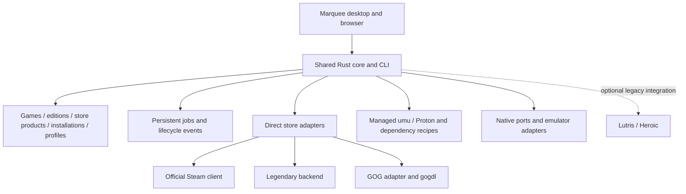

# Marquee roadmap

Updated 2026-10-21. This is the authoritative product direction and implementation order. The direct-store decision supersedes earlier Lutris-first plans and numbered phase ordering.

## Product decision

Marquee is the user's single game launcher: connect Steam, Epic, and GOG, see owned games together, install, update, and play. The user should not need to install or configure Lutris, Heroic, Wine prefixes, or helper commands themselves for the supported normal flow.

Marquee owns the interface, library, store-connection workflow, installation jobs, compatibility policy, runtime selection, prefixes, and per-game settings. Existing components supply store protocols and game execution. Lutris is not a product dependency or the authority for the user's store ownership. The existing Lutris bridge is legacy optional functionality; improving it is not on the critical path.

| Responsibility | Chosen direction |
| --- | --- |
| Steam | Direct Steam adapter; official Steam client performs login, installation, updates, and execution, including Proton |
| Epic | Direct Epic adapter driven by a tested Legendary backend |
| GOG | Direct GOG adapter; gogdl for supported authentication/download/update/launch operations, plus explicit library integration where needed |
| Windows games outside Steam | Marquee-managed umu/Proton, isolated prefixes, dependency recipes, and per-game fixes |
| Native games and ports | Direct executable/adaptor launch; no compatibility layer when a supported native build is chosen |
| Emulation | Per-system adapters and managed supported emulator builds; system/game data prerequisites remain explicit |
| Lutris/Heroic | Optional legacy imports or exceptional fallback, never required for connecting Steam/Epic/GOG |

Wine is an execution component. It does not provide owned-library sync, store authentication, game downloads, or patch management. Marquee must implement those workflows through store adapters. Helper reuse reduces protocol/runtime work; it does not make Marquee's orchestration automatic without implementation.

## Current implementation versus target

These are working-tree capabilities, not a claim that every live acceptance gate has passed.

| Area | Current state |
| --- | --- |
| Core and surfaces | Rust core/CLI, Tauri/Svelte desktop, shared authenticated loopback browser surface, event hub, MIT application license |
| Disc library | PS2 import/PCSX2 support; PS1 ISO/CHD and DuckStation slice added in the shared tree; live emulator acceptance remains tracked separately in [PS2](PS2.md) and [PS1](PS1.md) |
| Sessions and corrections | Persistent sessions, recovery/checkpoint work, staged port updates, mutation invalidation, and per-file scan warnings; see [correction report](CORRECTION_PASS.md) |
| Native ports | Five managed recipes; binary installation is not proof that required game data is ready |
| Unified library UI | Platform/run-method/source filters, explicit grouping, edition/run selectors, Jak/OpenGOAL reference assets; persistent normalized backend remains planned |
| Tools | Persisted external shortcuts, readiness checks, pinning, detected command presets, structured executable/arguments/cwd; see [Tools](LAUNCHERS.md) |
| Legacy Lutris bridge | Local read-only installed/cache projection and handoffs exist. Current code auto-discovers an existing database. Moving this behind an optional legacy integration is planned; documentation changes do not disable it |
| Direct Steam/Epic/GOG | Not implemented as end-to-end native store integrations. Command shortcuts and Lutris cache entries do not count as direct integrations |
| Compatibility automation | umu/Proton lifecycle, automatic prefix/dependency setup, and real Windows-app installation remain planned; the Windows-app wizard is a demo |
| Metadata and packaging | Serial covers exist; broader metadata, native gamepad integration, packaged updates, and release verification remain separate work |

## Work order

1. **S1 — Direct Steam:** installed library first, then authorized owned-library sync, installation handoff, and live launch/return evidence.
2. **C1 + E1 — Managed compatibility and Epic:** establish the minimum Windows runtime/prefix/job infrastructure needed by the first supported Epic game, then ship the Legendary-backed account/library/install/play flow.
3. **G1 — Direct GOG:** account/library integration, gogdl jobs, native-versus-Windows build selection, and the same lifecycle/UI contracts.
4. **U1 — Unified-library completion:** progressively persist shared identity/edition/installation/profile data as stores land; finish linking, defaults, saves, and controller-first polish.
5. Continue native-port and emulation expansion through [the catalogue](EXPANSION_CATALOGUE.md) and [Jak/OpenGOAL track](UNIFIED_LIBRARY.md), after the direct-store critical path unless explicitly reprioritized.
6. Packaging, distribution, updater, optional enrichment, and advanced collections.

Existing PS2/PS1 live gates remain open until actual evidence closes them. They remain acceptance requirements for those features; the owner has authorized direct-store work to proceed without waiting for them. Metadata providers, extra emulator generations, torrent integration, and legacy-launcher imports do not block S1/E1/G1.

Detailed implementation handoff: [Direct store integration](STORE_INTEGRATION.md). That document owns step-by-step store/runtime tasks and acceptance scenarios.

## Architecture

Separate **where a game was acquired**, **where its files are installed**, and **how it runs**. A GOG purchase remains a GOG product when launched through Proton. Two stores' releases of the same title can share a canonical game while retaining separate entitlements, editions, files, saves, and launch profiles. Never merge by title alone.

| Contract | Owns |
| --- | --- |
| Store adapter | Discovery, connection/authentication orchestration, owned-library sync, product/build/DLC identity, supported install/update/verify/remove operations |
| Runtime adapter | Compatible runtime detection/acquisition, version selection, prefix, dependencies, environment, executable/argv construction |
| Installation/job service | Destination selection, storage checks, progress/cancel/retry, readiness validation, recovery, safe update promotion |
| Session service | Verified actual game lifecycle, exit/return events, exactly-once time accounting; client handoff alone is not a game session |
| Library service | Stable identities, user titles/favorites/defaults, cached metadata, provider provenance, offline state |
| Tools service | Supported helper versions, health, acquisition/update/rollback, managed/external state; paths and argv stay advanced |
| Credential service | Backend-owned or OS-keyring credentials; redaction, expiry/reconnect, disconnect policy |

Extend the existing `api::dispatch` and event hub; browser, desktop, and CLI must share behavior. API contracts must report capability support rather than assuming all stores offer every action. Keep external-database reads read-only; use store clients/helpers for supported managed operations.

## S1 — Steam

- [ ] Move the current Lutris bridge behind an explicit optional legacy setting, preserving saved configurations and external data; remove it from default onboarding.
- [ ] Detect native and Flatpak Steam plus all library folders; no hardcoded single-root scan.
- [ ] Read manifests with a proper parser, stable app IDs, install states, missing/offline paths, and duplicate-root handling.
- [ ] Persist Steam products/installations without overwriting existing disc/port entries or user edits.
- [ ] Render real imported games in Library and game pages; artwork lookup cannot gate Play.
- [ ] Launch through the selected Steam installation; Steam owns its compatibility/runtime settings.
- [ ] Expose Install/Open in Steam for uninstalled products, then reconcile the actual installed state. Do not display a handoff as a completed download.
- [ ] Add a supported authorized owned-library path, with explicit credential/privacy prerequisites and cached/offline/error states. Installed games must work without a Marquee API key.
- [ ] Test real launch, return, rescan, restart, native/Flatpak selection, and missing-client behavior. Do not fabricate playtime from the Steam URI helper's process lifetime.

**First usable increment:** locally installed Steam games appear and launch from Marquee without Lutris.

**Full S1 acceptance:** the authorized account's owned and installed games appear with truthful states; installation handoff is explicit; installed titles launch; restart preserves IDs and user preferences; missing credentials never break local Play. Unsupported private-library access is reported, not represented as an empty owned library.

## C1 — Compatibility owned by Marquee

Build the minimum needed alongside Epic, then reuse it for GOG and later standalone Windows apps.

- [ ] Detect compatible existing umu/Proton components; acquire supported official builds when missing.
- [ ] Maintain helper/runtime version records, integrity evidence, installation health, rollback, and profile pinning. Never update a runtime underneath a running game.
- [ ] Create an isolated prefix per supported installation/profile; record executable, arguments, cwd, environment, runtime, and recipe version.
- [ ] Apply tested dependency/protonfix recipes with idempotent steps and useful errors. Windows installer/first-run prompts may still require interaction.
- [ ] Prefer a verified suitable native build when selected. Do not silently change build, language, save context, or mods.
- [ ] Track the game process/lifecycle through the chosen wrapper; expose diagnostics and repair. Prefix reset must not silently delete saves.

**Acceptance:** a supported non-Steam Windows game installs and runs from Marquee on a clean supported setup without the user configuring Lutris, Wine, prefixes, or shell commands. This is per-tested-game support, not a promise of universal Windows compatibility.

## E1 — Epic through Legendary

- [ ] Pin and health-check a tested Legendary backend; make upstream/fork selection explicit in the implementation record.
- [ ] Present Epic connect/reconnect/disconnect in Marquee and support required browser sign-in/MFA without exposing tokens to the UI.
- [ ] Sync the user's owned library and installation records directly from the selected backend; no Lutris cache dependency.
- [ ] Implement install, progress, cancellation, retry/resume, update/verify, DLC/build options, and failure recovery for supported capabilities.
- [ ] Integrate C1 and pass required game authentication through the store backend.
- [ ] Handle saves/cloud conflicts only through verified capabilities; installation and runtime settings persist across restarts.

**Acceptance:** on a machine without Lutris or Heroic, connect Epic → select an owned game → install with progress → play via the managed runtime → quit/return → restart and play again. Refresh, authentication expiry, offline cache, cancellation, and interrupted-job recovery remain truthful.

## G1 — GOG through a direct adapter and gogdl

- [ ] Pin and health-check gogdl; verify exactly which auth/library/download/install/update/verify/launch/save operations the selected version supports.
- [ ] Implement the account and owned-library adapter without assuming gogdl exposes a complete library-list command. Reuse verified backend operations; fill adapter gaps explicitly.
- [ ] Surface GOG sign-in/reconnect/disconnect in Marquee; keep tokens backend-side.
- [ ] Choose a supported native or Windows build, language, edition, DLC, and extras with clear defaults and storage impact.
- [ ] Reuse persistent jobs and C1 for Windows builds; launch native builds directly.
- [ ] Preserve installation/version/save records and implement offline behavior where the selected game/backend supports it.

**Acceptance:** without Lutris, Heroic, or GOG Galaxy, connect GOG → see owned games → install a supported title → play → update/verify where supported → restart/offline replay with honest prerequisites. Test native and Windows paths where both builds are supported.

## U1 — Library and UI completion

The normalized data model is shared infrastructure, implemented incrementally when S1 needs it rather than a separate store-blocking rewrite. Use the next available schema version; schema v4 is already allocated to PS1 root systems. Preserve legacy IDs through explicit mappings.

- Games → content editions → store products/entitlements → installations → launch profiles; project those into one canonical game page.
- Keep provider/product IDs even when accounts disconnect or builds are unavailable. Define hide/remove/cache policies independently of uninstalling files.
- Persist game favorites, titles, hidden status, preferred edition/install/profile, and independent histories. Missing defaults must offer alternatives explicitly.
- Keep store, platform, runtime, and install-state filters separate. Filters must match the same concrete installation.
- Normal first run: detect existing installations, offer Steam/Epic/GOG connections, show the real library. No required Tools/Add launcher/database-path step.
- Game page: truthful Install/Play/Update/Verify/Repair actions, edition/run choice, data readiness, screenshots with provenance, and visible errors.
- Downloads: persistent installation jobs, progress, cancellation, retries, and recovery across desktop/browser. Unsupported delegated progress is labeled as a handoff.
- Tools: automatically managed components and health; custom commands/paths are advanced overrides.
- Validate large libraries and keyboard/controller focus. Native Tauri gamepad support and visual/performance testing remain explicit gates.

## Native ports, emulation, and enrichment

Preserve existing work and correctness gates:

- [PS2 slice](PS2.md): PCSX2 setup, user-owned ISO/BIOS, live launch/exit/time evidence.
- [PS1 slice](PS1.md): DuckStation, per-system roots, supported ISO/CHD, separate live gate.
- [Expansion catalogue](EXPANSION_CATALOGUE.md): prioritized platforms, port families, legitimate game-data requirements, shelves, streaming, and adapter limits.
- [Unified-library/OpenGOAL track](UNIFIED_LIBRARY.md): explicit editions/run methods, reference assets, managed Jak extraction and runtime support.
- [Metadata follow-up](PS2_METADATA_FOLLOWUP.md): ScreenScraper prerequisites and SteamGridDB matching. Broader [metadata and UI enrichment](ENRICHMENT.md) is optional background work and never gates Play.
- Port installers keep staged extraction, bounded archives, integrity checks, user-data preservation, and rollback. “Binary installed” and “game data ready” remain separate.
- Port data discovery consumes direct Steam/GOG installation records. A Lutris database is not a prerequisite.
- BIOS, firmware, original ROM/disc assets, and native-port extraction inputs remain user-supplied. Store-authorized downloads of owned Steam/Epic/GOG games are in scope; the earlier blanket “no game downloads” wording is superseded.

## Packaging and later work

- AppImage/RPM first; packaged helper/runtime acquisition, version pinning, notices, and update recovery.
- Signed application/catalogue updates and a documented release process. Do not claim a helper is bundled, signed, licensed for a distribution arrangement, or supported before verifying that arrangement.
- First-run setup must install/configure supported dependencies within Marquee's flow; explain unavoidable OS package or store prompts when they actually occur.
- Optional later work: save backup/restore, Steam shortcut export, Gamescope sessions, remote-play adapters, collections, metadata enrichment, additional stores and standalone Windows-app recipes.
- Lutris/Heroic import/fallback remains optional legacy work. No additional Lutris installation/onboarding milestone is required to ship S1/E1/G1.
- Torrent/tracker integration is deferred outside the current UI/store/runtime scope.

## Verification and handoff rules

For each increment, record the build/helper version, supported environment, tests, actual live scenarios, and unresolved limits. Fake runners, browser demos, installer handoffs, and cached account listings are not evidence of real game launch or successful installation.

Run checks appropriate to the changed code (`scripts/check.sh` for implementation work); document shared-tree/concurrent-change blockers instead of resetting another contributor's work. Documentation-only edits need consistency, link, and whitespace checks rather than unrelated runtime tests.

Retain open emulator acceptance items while proceeding with the owner-authorized store order. No blanket metadata-completeness or compatibility percentage is required to close a store slice. The gate is a verified user-owned game workflow with honest failure/offline states.

## Technical sources

These describe external capabilities, not implementation completion in Marquee:

- [Steam Web API](https://steamcommunity.com/dev), [Steam authentication](https://partner.steamgames.com/doc/features/auth), [owned-game API](https://partner.steamgames.com/doc/webapi/IPlayerService).
- [Legendary](https://github.com/legendary-gl/legendary): Epic authentication, downloads, updates, launch authentication, and supported save operations.
- [gogdl](https://github.com/Heroic-Games-Launcher/heroic-gogdl): helper intended for another application to drive; verify library/auth/CLI boundaries before implementation.
- [umu-launcher](https://github.com/Open-Wine-Components/umu-launcher): Proton runtime execution outside Steam.
- [Heroic](https://github.com/Heroic-Games-Launcher/HeroicGamesLauncher): reference architecture using Legendary, gogdl, and runtime components. Heroic itself is not required.
