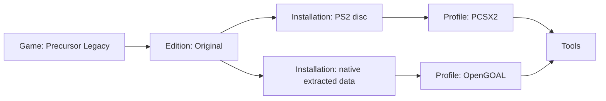

# Unified games, editions, and launch choices

Updated 2026-10-22. The UI projection and Jak reference example are implemented. The [roadmap](ROADMAP.md) now puts the hidden [manager foundation](MARQUEE_MANAGER.md) first, then preserves Steam → compatibility/Epic → GOG store order. The normalized library model is shared infrastructure delivered incrementally for receipt publication and stores; managed OpenGOAL remains a separate follow-up track. The manager owns artifacts/preparation/receipts; the library owns identities/profiles/sessions. This document does not require Lutris or define a competing job registry.

## Product decision

A unified library makes sense. Show a game once, then let the player choose an edition and an installed way to run it. Keep emulator configuration in Tools rather than making the library a list of executables.

These concepts need separate identities:

| Concept | Example | Owns |
| --- | --- | --- |
| Game | Jak and Daxter: The Precursor Legacy | Shared title, cover, descriptions, gallery |
| Edition | Original retail game | Content/release identity; future anniversary or complete editions belong here |
| Installation | US PS2 ISO; native OpenGOAL extraction | Actual files, region, revision, data readiness, saves, play history |
| Launch profile | PS2 installation through PCSX2; native installation through OpenGOAL | Tool, argv array, working directory, environment overrides, per-install options |
| Tool | PCSX2, OpenGOAL launcher, Steam | Detected or managed executable, version, health, setup action |

OpenGOAL is another implementation of the original game; it does not create a fictional “anniversary edition.” A PS3 HD release would be a separate edition with its own media and adapter. A soundtrack/DLC entitlement does not automatically create another installation. Mods can be profiles when they share compatible assets, or separate installations when they change data/save compatibility.

Never merge by filename or display title. Equal names can be unrelated games; identical discs can have different patches, revisions, languages, or save compatibility. Group through a verified catalogue mapping or a user-confirmed link. Retain original installation IDs even after grouping.

## Implemented in this pass

- `src/lib/unified.ts` supplies explicit canonical identity, edition keys, launch methods, grouping, filtering, and native-port projection.
- Library groups explicitly linked entries and shows their play-option count. Source, platform, run method, installed, and favourite filters apply to concrete entries before grouping. A PS2 + native filter cannot match two different installations by accident.
- Game pages offer edition and run selectors. Selection changes the concrete entry used for Play, rather than launching the representative card by mistake.
- The Jak browser demo contains the original PS2 option and an uninstalled OpenGOAL option. Existing demo installation/progress simulation applies; it is not evidence of a downloaded or playable game.
- Real imported `SCUS-97124` discs receive the same catalogue identity and reference art without changing IDs, personal titles, favorites, or time. Other serial mappings need separate verification before addition.
- Installed native ports enter the real library and dispatch to the existing port launcher. Their playtime/favorites are not implemented; the detail page says tracking is unavailable and disables favorite changes rather than inventing records.
- Tools exposes detected PCSX2 runners, default selection, setup, installation, native port management/folders, and the planned PC launcher category. Category visibility persists per browser/window. A subsequent UI pass added persisted external launcher shortcuts, detection, pinning, and Open actions; see [Tools and launchers](LAUNCHERS.md). Store library import adapters remain unconnected.
- Session recovery added schema v3; subsequent PS1 root-system work uses schema v4. The proposed normalized game/edition/installation schema is not implemented by the UI projection and must use a future available migration version.

## Games without files

Library → **Add games → Add a game without files…**: type a title, pick the system and a status (**Wishlist**, or **I own it** when the files are elsewhere). The game appears in the Library with a "Wishlist" or "No files" badge and a disabled **Play · no files yet** button. Code: `crates/core/src/wanted.rs`, table `wanted`.

### Wanted-entry behavior

- A wanted game is an ordinary edition with no media, so favourites, rename, search, covers and facts work unchanged. A typed title is stored as the user's own title, so "remove missing games" keeps it.
- **Cover and facts by name.** For cartridge systems the typed title is matched to the official libretro No-Intro list (USA release preferred, then Europe, then World, never homebrew over retail), which gives the official name for the libretro cover and the checksum for genre, year, developer and publisher. Descriptions and player counts come from TheGamesDB (see [enrichment](ENRICHMENT.md#fact-storage-and-identity-limits)); disc systems use the title as typed. The same conservative name-match safeguards apply; no match keeps the placeholder. Name matching is not verified release identity.
- **Files attach themselves.** When a scan or an [archive intake](INTAKE.md) brings in a file for the same system whose name is the same game (`Super Mario Bros. (USA).nes` for "Super Mario Bros."), it is attached to that entry, the wanted status is removed, and Play enables. No duplicate entry is created; your typed title is kept.
- **Library filter** "Without files" shows wishlist entries and games whose files are currently missing.
- Game page: **I own this / Move to wishlist**, **Remove** (only for entries without files; a game with files is never removed from here), **Fetch cover**.

### Wanted-entry limits

- Adding is manual and one game at a time; there is no import of a list yet.
- Matching a file is by name only (not checksum), so a badly named file will not attach; it appears as a separate game and the wanted entry can be removed.
- Games with several discs share a name, so only the first disc attaches.
- API: `add_wanted_game`, `set_wanted_status`, `remove_wanted_game`; no CLI command yet.

## Reference assets and provenance

Local assets: `apps/desktop/public/reference/jak/`. `sources.json` records exact URLs, SHA-256, sizes, retrieval date, and the pinned OpenGOAL repository revision.

| Asset | Purpose | Source |
| --- | --- | --- |
| `cover.jpg` | PS2 US box cover | [xlenore PS2 covers](https://github.com/xlenore/ps2-covers), SCUS-97124 |
| `hero.webp` | Detail-page backdrop, Sandover scene | [OpenGOAL website source](https://github.com/open-goal/open-goal.github.io) |
| `sunset.webp`, `night.webp` | Alternate backdrops for later day/night themes | Same pinned source |
| `misty-island.avif`, `geyser-rock.avif`, `subtitles.avif` | Native-port promotional gameplay captures | [OpenGOAL promotional gallery](https://opengoal.dev/docs/gallery/jak1/promo/) |
| `opengoal-logo.png` | Tool/provider badge for later UI refinement | OpenGOAL website source |

The gallery images depict OpenGOAL, not a PCSX2 capture; the UI captions and credit say so. Full-resolution AVIFs are retained and loaded lazily. The upstream site's small JPEG previews returned HTTP 403 when requested; they were not substituted with fabricated images. These are third-party reference assets and are not relicensed by Marquee's code license. Review media permissions before public redistribution.

No ISO, BIOS, extracted proprietary assets, or prepackaged game executable was downloaded. The [OpenGOAL FAQ](https://opengoal.dev/docs/faq/) calls for the user's own original PS2 game and supports retail PS2 releases; PS3/PS4/PS5 packages are not substitutes for that extraction flow.

## Shared identity work and later OpenGOAL track

Saved-provider metadata now uses additive schema v5: see [Catalogue metadata](CATALOGUE_METADATA.md).
Its explicit media links enrich installations without performing canonical-game
merges or replacing the normalized model proposed below. Future migrations must
use a version after v6 (v6 is allocated to preparation receipts). ROM revision selectors are separate from content editions
and run methods.

1. **Retain existing migration coverage, including v3 sessions and v4 PS1 roots.** Keep the correction regressions. Take an SQLite backup before testing any later migration against a real library. Do not reset dirty trees or replace the user's database with demo data.
2. **Add an additive normalized library model at the next available schema version.** Create `games`, content `game_editions`, `installations`, `tools`, and installation-scoped `launch_profiles`. Maintain legacy edition IDs as installation IDs or keep an explicit stable ID mapping. Copy existing media, artwork references, favorites and history transactionally. Unknown identities initially get one canonical game each.
3. **Preserve history correctly.** Existing sessions reference their concrete installation. Show aggregate game time by summing sessions, while keeping per-install time and filters. Do not merge save directories. Separate game-level favorites from optional installation preferences.
4. **Provide manual linking and undo.** Select two entries → “Same game” → review proposed shared identity → choose content editions. Unlinking changes relationships, never deletes media/history. Verify serial-based mappings and record their provider/revision.
5. **Introduce a tool adapter contract.** Each adapter declares supported platforms and methods, detection, version probe, setup action, data readiness, argv construction, working directory, environment, and process lifecycle. Store executable and arguments separately. Continue using `Command::args`, never `sh -c`.
6. **Add OpenGOAL as a managed tool.** Start with the official [launcher](https://github.com/open-goal/launcher) for extraction and settings. Detect an existing install first. Use official release assets, version pinning/digests where published, staging, and rollback. Do not put OpenGOAL into a generic single-binary port recipe until its layout and lifecycle are verified.
7. **Acquire and extract Jak disc data.** A manager preparation job selects or downloads the PS2 image from an authorized source, identifies game/region/revision, runs the documented extractor into the chosen install directory, and keeps the source read-only. Report progress/cancellation. Incomplete extraction is “needs game data,” not Ready. Manual ISO pick remains a fallback.
8. **Launch the correct game.** Validate the installed OpenGOAL runtime's documented CLI and game-selection arguments rather than assuming `gk` alone works for every release. Track the actual game process or a verified wrapper lifecycle. Avoid crediting launcher-menu time.
9. **Persist the user's default.** Remember edition + installation + profile per canonical game. A default points to a stable ID; a missing default offers available alternatives without silently switching a player's mod/region/save context. Explicit per-game overrides should remain separate from the global tool default.
10. **Expose save boundaries.** Label per-install save locations and provide “open saves.” Offer copy/import only when a tested converter exists. Version and back up saves before conversion; PCSX2 memory cards and OpenGOAL saves must not be treated as interchangeable files.
11. **Complete Tools configuration.** Custom executable/argv/working-directory configurations, health checks, and pinning already use the core. Extend this with automatically managed Steam/Legendary/gogdl/umu/Proton health and supported setup, installation-scoped profiles, reorder/hide, and managed/external labels. Keep custom commands advanced; never require Lutris configuration for the normal flow. Local category visibility can remain a device preference.
12. **Extend metadata independently.** Add artwork/title matching and provider provenance in background jobs. A missing API key, no matching image, or provider outage must never gate Play. Keep screenshots associated with their edition/implementation and label shared art explicitly.
13. **Acceptance test on actual user-owned media.** Import Jak → identify original edition → extract native data → one library card with PS2 and native choices → both launch correctly → close/reopen Marquee while playing → no second launch → history survives → change global default and per-game override independently → unlink/relink without losing saves or history.

## Later expansion

- Saved shelves such as “PS2 originals,” “Native rebuilds,” “Controller-ready,” “Needs setup,” “Short games,” and “Recently installed.” Shelves query the shared library; they do not duplicate games.
- Per-game profiles for original presentation, widescreen/HD textures, accessibility mods, and speedrunning. Display which choices alter saves or gameplay.
- Edition comparison showing content differences, language/revision, supported controllers, data requirements, storage, and adapter health. Avoid generic claims that one runtime is always superior.
- Tool updates separate from game-data updates, with a pinned runtime per profile and rollback. Store provenance (Steam/Epic/GOG) stays separate from runtime (native/umu/Proton); helpers do not become the game source.
- Add console/store adapters one at a time with real launch/exit evidence. A PlayStation generation label is not proof that a usable emulator adapter exists. Leave unsupported generations unavailable rather than showing a fake Play button.

## Verification limits

Unit/state tests and production builds cover the grouping and dispatch rules. This tool session has no available browser surface, so rendered layout, selector interaction, and WebKit AVIF decoding still need a visual smoke test. No commercial game or OpenGOAL extraction was run.

Preview with `pnpm --dir apps/desktop dev`, then open `/?route=game&game=jak-ps2&splash=0` in the Vite browser demo. Check the edition/run selectors, native not-installed state, image gallery, platform/method filters, and Tools category persistence. Use a separate data directory for any fake-runner backend tests.
